# Keyboard Heist: branch map

<!-- Generated by tools/branches.js from STORY in index.html. Do not edit by hand; rerun the script. -->

60 scenes, 8 real endings (solid green, or solid red in Hell), 5 dead ends (dashed diamonds). Red boxes are Hell.

```mermaid
flowchart TD
  arrival["Quick printer help? 🙂"]:::scene
  office["Head to his office."]:::scene
  plan["The plan"]:::scene
  outage["The outage"]:::scene
  grandmother["The grandmother"]:::scene
  visit["The visit"]:::scene
  audit["The audit"]:::scene
  swap["The swap"]:::scene
  choice["The choice"]:::scene
  lie["The lie"]:::scene
  end_plateau["The plateau"]:::finale
  end_spare{"The spare"}:::dead
  end_mom{"Long distance"}:::dead
  end_method{"Method"}:::dead
  end_red{"Asset not found"}:::dead
  restart["Have you tried restarting the printer?"]:::scene
  ceremony["The ceremony"]:::scene
  end_sick["Call in sick Friday."]:::scene
  end_speech["Say a few words."]:::scene
  walk_away["Stand up. Walk away. Never think about this again."]:::scene
  resigned["The resignation"]:::scene
  end_sabbatical["Take the sabbatical."]:::scene
  ask["Just ask him about it."]:::scene
  garage["The garage"]:::scene
  end_founding["The founding keyboard"]:::scene
  end_borrowed["Borrow it for the weekend."]:::scene
  printer_model["Look up the printer’s model in inventory."]:::scene
  lemon["Say “thank you” and sit down."]:::scene
  draft["Save it as a draft."]:::scene
  typo["Say it was a typo."]:::scene
  declined["Say you couldn’t possibly."]:::scene
  invoices["Go look."]:::scene
  wizard["Take it back to him."]:::scene
  end_wizard["Eleven years"]:::finale
  refuse["The first no"]:::finale
  end_report{"The fall guy"}:::dead
  pretend["Walk out and pretend you never saw it."]:::scene
  jordan_drink["Get a drink after work."]:::scene
  jordan_weeks["See them again."]:::scene
  jordan_together["The one who didn’t laugh"]:::finale
  jordan_breakup["Say you’re just tired."]:::scene
  subgraph HELL["Hell"]
    end_running["Keep running."]:::hellScene
    hell_upstairs["Not the hero"]:::hellFinale
    hell_orientation["Orientation"]:::hellScene
    hell_grab["Steal it. Walk out."]:::hellScene
    hell_committee["Give it back before morning."]:::hellScene
    hell_quiet["Say nothing. Let them take the fall."]:::hellScene
    hell_form["Confess on Form 666. Bring them back."]:::hellScene
    hell_devil["The corner office"]:::hellScene
    hell_job["Driver unavailable"]:::hellFinale
    hell_plateau["The lower plateau"]:::hellFinale
    hell_plan["The plan, again"]:::hellScene
    hell_lake["Swap it at the huddle. Hide the real one in the Lake of Fire."]:::hellScene
    hell_ask["Just ask for it."]:::hellScene
    hell_count["Say no thanks. Steal it at the huddle."]:::hellScene
    hell_offer["The Devil’s offer"]:::hellScene
    hell_trade["Trade him Daniel’s keyboard."]:::hellScene
    hell_lost["Lost and found"]:::hellFinale
    hell_truth["Say no. Give it all back."]:::hellScene
    hell_return["Return to sender"]:::hellScene
  end
  arrival -->|"Head to his office."| office
  arrival -->|"Reply, “Have you tried restarting the printer?”"| restart
  arrival -->|"Look up the printer’s model in inventory."| printer_model
  office -->|"Take it. Right now."| end_spare
  office -->|"Leave it. Come back for it later."| plan
  office -->|"Stand up. Walk away. Never think about this again."| walk_away
  plan -->|"Case the office."| outage
  plan -->|"Just ask him about it."| ask
  outage -->|"Back out. Think."| grandmother
  grandmother -->|"Hire Mrs. Cox."| visit
  grandmother -->|"Forget it. Use your mother in Ohio."| end_mom
  visit -->|"Pay her and move on."| audit
  visit -->|"Let Mrs. Cox keep going."| end_method
  audit -->|"Make a tag."| swap
  audit -->|"Skip it. Nobody checks."| end_red
  swap -->|"Look at him."| choice
  choice -->|"VIRTUE: Go back with the inhaler."| lie
  choice -->|"SIN: Keep running."| end_running
  lie -->|"Go home."| end_plateau
  end_running -->|"SIN: Sign in. Keep the keyboard."| hell_orientation
  end_running -->|"VIRTUE: Run back up and face it."| hell_upstairs
  hell_orientation -->|"SIN: Steal it. Walk out."| hell_grab
  hell_orientation -->|"VIRTUE: Hand it back. Smile."| hell_plan
  hell_grab -->|"SIN: Say nothing. Let them take the fall."| hell_quiet
  hell_grab -->|"VIRTUE: Give it back before morning."| hell_committee
  hell_committee -->|"Take the minutes."| hell_plateau
  hell_quiet -->|"SIN: Make a deal with the Devil."| hell_devil
  hell_quiet -->|"VIRTUE: Confess on Form 666. Bring them back."| hell_form
  hell_form -->|"Wait."| hell_plateau
  hell_devil -->|"SIN: Sell him Daniel’s keyboard."| hell_job
  hell_devil -->|"VIRTUE: Refuse. Walk out."| hell_plateau
  hell_plan -->|"SIN: Swap it at the huddle. Hide the real one in the Lake of Fire."| hell_lake
  hell_plan -->|"VIRTUE: Just ask for it."| hell_ask
  hell_lake -->|"Report to Lost and Found."| hell_lost
  hell_ask -->|"SIN: Say no thanks. Steal it at the huddle."| hell_count
  hell_ask -->|"VIRTUE: Say no thanks. Let them keep it."| hell_offer
  hell_count -->|"Take it to Lost and Found."| hell_lost
  hell_offer -->|"SIN: Trade him Daniel’s keyboard."| hell_trade
  hell_offer -->|"VIRTUE: Say no. Give it all back."| hell_truth
  hell_trade -->|"Drop it at Lost and Found."| hell_lost
  hell_truth -->|"Get in the elevator."| hell_return
  hell_return -->|"Go back with the inhaler."| lie
  restart -->|"Go to the ceremony."| ceremony
  restart -->|"Call in sick Friday."| end_sick
  ceremony -->|"Say a few words."| end_speech
  ceremony -->|"Say “thank you” and sit down."| lemon
  end_sick -->|"Go thank Daniel for the soup."| office
  end_speech -->|"Get a drink after work."| jordan_drink
  walk_away -->|"Send it."| resigned
  walk_away -->|"Save it as a draft."| draft
  resigned -->|"Take the sabbatical."| end_sabbatical
  resigned -->|"Say it was a typo."| typo
  end_sabbatical -->|"Go back early."| plan
  ask -->|"Let him finish."| garage
  ask -->|"Ask if you could have it."| end_founding
  garage -->|"Take it."| end_founding
  garage -->|"Borrow it for the weekend."| end_borrowed
  garage -->|"Say you couldn’t possibly."| declined
  end_founding -->|"Go look."| invoices
  end_borrowed -->|"Back to the plan."| outage
  printer_model -->|"Head to his office."| office
  lemon -->|"Head to his office."| office
  draft -->|"Look it up."| plan
  typo -->|"Figure out how."| plan
  declined -->|"Back to the plan."| outage
  invoices -->|"Take it back to him."| wizard
  wizard -->|"Ask him to show you."| end_wizard
  wizard -->|"Tell him no."| refuse
  wizard -->|"Report him."| end_report
  wizard -->|"Walk out and pretend you never saw it."| pretend
  pretend -->|"Get back to the plan."| outage
  jordan_drink -->|"See them again."| jordan_weeks
  jordan_weeks -->|"Tell them everything."| jordan_together
  jordan_weeks -->|"Say you’re just tired."| jordan_breakup
  jordan_breakup -->|"Think about something else."| office
  linkStyle 19,20,21,22,23,24,25,26,27,28,29,30,31,32,33,34,35,36,37,38,39,40,41 stroke:#ff5a3c
  classDef scene fill:#f6f1e3,stroke:#193b37,color:#193b37
  classDef finale fill:#d8eeaa,stroke:#193b37,stroke-width:3px,color:#193b37
  classDef dead fill:#f6f1e3,stroke:#193b37,stroke-dasharray:4 3,color:#193b37
  classDef hellScene fill:#3a1410,stroke:#ff5a3c,color:#f5e6e2
  classDef hellFinale fill:#ff5a3c,stroke:#3a1410,stroke-width:3px,color:#1c0c0b
  classDef hellDead fill:#3a1410,stroke:#ff5a3c,stroke-dasharray:4 3,color:#f5e6e2
  style HELL fill:#1c0c0b,stroke:#ff5a3c,color:#ff5a3c
```

## Every scene

Each scene name jumps to its full text below; “code” opens it in `index.html`.

| Scene | Kind | Leads to | Code |
| --- | --- | --- | --- |
| [Quick printer help? 🙂](#arrival) `arrival` | Scene | [`office`](#office), [`restart`](#restart), [`printer_model`](#printer_model) | [code](index.html#L41) |
| [Head to his office.](#office) `office` | Scene | [`end_spare`](#end_spare), [`plan`](#plan), [`walk_away`](#walk_away) | [code](index.html#L74) |
| [The plan](#plan) `plan` | Scene | [`outage`](#outage), [`ask`](#ask) | [code](index.html#L107) |
| [The outage](#outage) `outage` | Scene | [`grandmother`](#grandmother) | [code](index.html#L131) |
| [The grandmother](#grandmother) `grandmother` | Scene | [`visit`](#visit), [`end_mom`](#end_mom) | [code](index.html#L149) |
| [The visit](#visit) `visit` | Scene | [`audit`](#audit), [`end_method`](#end_method) | [code](index.html#L173) |
| [The audit](#audit) `audit` | Scene | [`swap`](#swap), [`end_red`](#end_red) | [code](index.html#L196) |
| [The swap](#swap) `swap` | Scene | [`choice`](#choice) | [code](index.html#L217) |
| [The choice](#choice) `choice` | Scene | [`lie`](#lie), [`end_running`](#end_running) | [code](index.html#L235) |
| [The lie](#lie) `lie` | Scene | [`end_plateau`](#end_plateau) | [code](index.html#L260) |
| [The plateau](#end_plateau) `end_plateau` | Real ending | (end) | [code](index.html#L279) |
| [The spare](#end_spare) `end_spare` | Dead end | (end) | [code](index.html#L295) |
| [Long distance](#end_mom) `end_mom` | Dead end | (end) | [code](index.html#L311) |
| [Method](#end_method) `end_method` | Dead end | (end) | [code](index.html#L323) |
| [Asset not found](#end_red) `end_red` | Dead end | (end) | [code](index.html#L335) |
| [Keep running.](#end_running) `end_running` (Hell) | Scene | [`hell_orientation`](#hell_orientation), [`hell_upstairs`](#hell_upstairs) | [code](index.html#L347) |
| [Not the hero](#hell_upstairs) `hell_upstairs` (Hell) | Real ending | (end) | [code](index.html#L371) |
| [Orientation](#hell_orientation) `hell_orientation` (Hell) | Scene | [`hell_grab`](#hell_grab), [`hell_plan`](#hell_plan) | [code](index.html#L385) |
| [Steal it. Walk out.](#hell_grab) `hell_grab` (Hell) | Scene | [`hell_quiet`](#hell_quiet), [`hell_committee`](#hell_committee) | [code](index.html#L409) |
| [Give it back before morning.](#hell_committee) `hell_committee` (Hell) | Scene | [`hell_plateau`](#hell_plateau) | [code](index.html#L432) |
| [Say nothing. Let them take the fall.](#hell_quiet) `hell_quiet` (Hell) | Scene | [`hell_devil`](#hell_devil), [`hell_form`](#hell_form) | [code](index.html#L448) |
| [Confess on Form 666. Bring them back.](#hell_form) `hell_form` (Hell) | Scene | [`hell_plateau`](#hell_plateau) | [code](index.html#L472) |
| [The corner office](#hell_devil) `hell_devil` (Hell) | Scene | [`hell_job`](#hell_job), [`hell_plateau`](#hell_plateau) | [code](index.html#L489) |
| [Driver unavailable](#hell_job) `hell_job` (Hell) | Real ending | (end) | [code](index.html#L512) |
| [The lower plateau](#hell_plateau) `hell_plateau` (Hell) | Real ending | (end) | [code](index.html#L527) |
| [The plan, again](#hell_plan) `hell_plan` (Hell) | Scene | [`hell_lake`](#hell_lake), [`hell_ask`](#hell_ask) | [code](index.html#L542) |
| [Swap it at the huddle. Hide the real one in the Lake of Fire.](#hell_lake) `hell_lake` (Hell) | Scene | [`hell_lost`](#hell_lost) | [code](index.html#L566) |
| [Just ask for it.](#hell_ask) `hell_ask` (Hell) | Scene | [`hell_count`](#hell_count), [`hell_offer`](#hell_offer) | [code](index.html#L583) |
| [Say no thanks. Steal it at the huddle.](#hell_count) `hell_count` (Hell) | Scene | [`hell_lost`](#hell_lost) | [code](index.html#L606) |
| [The Devil’s offer](#hell_offer) `hell_offer` (Hell) | Scene | [`hell_trade`](#hell_trade), [`hell_truth`](#hell_truth) | [code](index.html#L624) |
| [Trade him Daniel’s keyboard.](#hell_trade) `hell_trade` (Hell) | Scene | [`hell_lost`](#hell_lost) | [code](index.html#L647) |
| [Lost and found](#hell_lost) `hell_lost` (Hell) | Real ending | (end) | [code](index.html#L664) |
| [Say no. Give it all back.](#hell_truth) `hell_truth` (Hell) | Scene | [`hell_return`](#hell_return) | [code](index.html#L678) |
| [Return to sender](#hell_return) `hell_return` (Hell) | Scene | [`lie`](#lie) | [code](index.html#L694) |
| [Have you tried restarting the printer?](#restart) `restart` | Scene | [`ceremony`](#ceremony), [`end_sick`](#end_sick) | [code](index.html#L710) |
| [The ceremony](#ceremony) `ceremony` | Scene | [`end_speech`](#end_speech), [`lemon`](#lemon) | [code](index.html#L732) |
| [Call in sick Friday.](#end_sick) `end_sick` | Scene | [`office`](#office) | [code](index.html#L753) |
| [Say a few words.](#end_speech) `end_speech` | Scene | [`jordan_drink`](#jordan_drink) | [code](index.html#L769) |
| [Stand up. Walk away. Never think about this again.](#walk_away) `walk_away` | Scene | [`resigned`](#resigned), [`draft`](#draft) | [code](index.html#L786) |
| [The resignation](#resigned) `resigned` | Scene | [`end_sabbatical`](#end_sabbatical), [`typo`](#typo) | [code](index.html#L808) |
| [Take the sabbatical.](#end_sabbatical) `end_sabbatical` | Scene | [`plan`](#plan) | [code](index.html#L831) |
| [Just ask him about it.](#ask) `ask` | Scene | [`garage`](#garage), [`end_founding`](#end_founding) | [code](index.html#L847) |
| [The garage](#garage) `garage` | Scene | [`end_founding`](#end_founding), [`end_borrowed`](#end_borrowed), [`declined`](#declined) | [code](index.html#L869) |
| [The founding keyboard](#end_founding) `end_founding` | Scene | [`invoices`](#invoices) | [code](index.html#L895) |
| [Borrow it for the weekend.](#end_borrowed) `end_borrowed` | Scene | [`outage`](#outage) | [code](index.html#L912) |
| [Look up the printer’s model in inventory.](#printer_model) `printer_model` | Scene | [`office`](#office) | [code](index.html#L928) |
| [Say “thank you” and sit down.](#lemon) `lemon` | Scene | [`office`](#office) | [code](index.html#L944) |
| [Save it as a draft.](#draft) `draft` | Scene | [`plan`](#plan) | [code](index.html#L960) |
| [Say it was a typo.](#typo) `typo` | Scene | [`plan`](#plan) | [code](index.html#L975) |
| [Say you couldn’t possibly.](#declined) `declined` | Scene | [`outage`](#outage) | [code](index.html#L992) |
| [Go look.](#invoices) `invoices` | Scene | [`wizard`](#wizard) | [code](index.html#L1009) |
| [Take it back to him.](#wizard) `wizard` | Scene | [`end_wizard`](#end_wizard), [`refuse`](#refuse), [`end_report`](#end_report), [`pretend`](#pretend) | [code](index.html#L1027) |
| [Eleven years](#end_wizard) `end_wizard` | Real ending | (end) | [code](index.html#L1061) |
| [The first no](#refuse) `refuse` | Real ending | (end) | [code](index.html#L1077) |
| [The fall guy](#end_report) `end_report` | Dead end | (end) | [code](index.html#L1093) |
| [Walk out and pretend you never saw it.](#pretend) `pretend` | Scene | [`outage`](#outage) | [code](index.html#L1107) |
| [Get a drink after work.](#jordan_drink) `jordan_drink` | Scene | [`jordan_weeks`](#jordan_weeks) | [code](index.html#L1124) |
| [See them again.](#jordan_weeks) `jordan_weeks` | Scene | [`jordan_together`](#jordan_together), [`jordan_breakup`](#jordan_breakup) | [code](index.html#L1142) |
| [The one who didn’t laugh](#jordan_together) `jordan_together` | Real ending | (end) | [code](index.html#L1164) |
| [Say you’re just tired.](#jordan_breakup) `jordan_breakup` | Scene | [`office`](#office) | [code](index.html#L1179) |

## The full story

Every scene in story order, with its choices. Click a choice to jump to the scene it leads to.

### Quick printer help? 🙂

`arrival` · Scene

You’re the IT Support Manager. You’ve spent the last few months waking up, fixing problems, going home, and waiting until it’s reasonable to go to bed. Nothing is especially wrong. Nothing is especially interesting. You’ve reached the plateau, apparently, and the view is mostly Outlook.

Then a ticket pops up...

> **From:** Daniel Hall, CEO 
> **Subject:** Quick printer help? 🙂 
> Hey! Having trouble getting the new printer working. Think it needs a driver? Whenever you have a minute. Appreciate you!

A printer driver. You hate those.

- [Head to his office.](#office) *Maybe walking somewhere will count as feeling something.*
- [Reply, “Have you tried restarting the printer?”](#restart) *You deserve to ask. Once.*
- [Look up the printer’s model in inventory.](#printer_model) *There’s still a professional somewhere inside you.*

### Head to his office.

`office` · Scene

Forty-three seconds to Daniel’s office. His door is open, because his door is always open.

He looks up and his whole face reorganizes into welcome. “Hey! Gosh, thanks for coming down. Did you eat? I have a granola bar.”

You did eat. You decline. He apologizes for the ticket, for the printer, for having a printer at all.

There’s a Bible verse on a Post-it stuck to his monitor. A framed photo of his kids on the desk.

He offers you his chair. His phone lights up. “Sorry, gotta grab this. Holler if you need anything.” He steps out. The door doesn’t quite close.

You put your hands on the keyboard because your hands have to go somewhere.

You type your name. It’s a nothing keyboard, the kind companies buy in bulk for executives. You type your name again.

You’ve been typing on keyboards for twenty-two years. You have never noticed a keyboard before. You are noticing this keyboard.

You type a whole sentence: “Something is wrong with me.” You backspace it. The backspace also feels wonderful.

Daniel is still on the phone. Your hands are still on the keyboard.

- [Take it. Right now.](#end_spare) *You could be out of the building in ninety seconds. Probably.*
- [Leave it. Come back for it later.](#plan) *You’d finish clean. You’d plan. That’s who you are.*
- [Stand up. Walk away. Never think about this again.](#walk_away) *Everyone would tell you it’s the correct choice.*

### The plan

`plan` · Scene

You can’t stop thinking about the keyboard. Dinner, TV, the usual nothing. Except your fingers keep typing on the couch cushion.

You look it up. Full-size. Black and gray. $149.99. Four and a half stars. One reviewer wrote, “It’s a keyboard.” You buy one.

It arrives in a box big enough for a small pizza. You type your name at the kitchen table. Nothing. Same model, same clack. It has to be his. Some of his soul got into that one, or something. An x factor you cannot explain, and it draws you. Well. Now you have a decoy.

You’re early the next morning. You open a spreadsheet. Column A: Daniel’s schedule. Column B: Things that could go wrong. It’s the most alive you’ve felt in months, and it’s a crime. Or it will be.

IT can go anywhere. Nobody asks why. Daniel eats lunch at 12:15 and leaves his door open. Always. His assistant, Marcy, sits outside it and sees everything.

Over her shoulder, her calendar: the company retreat, next Friday. Daniel brings his own keyboard to everything. She calls it “the founding keyboard.” He started the company on it. Once it leaves the building, it’s gone.

- [Case the office.](#outage) *Professionally. You are a professional.*
- [Just ask him about it.](#ask) *Normal. He might even say yes.*

### The outage

`outage` · Scene

Daniel leaves for a meeting. His office is empty. You make it to the doorway. Marcy looks up. You crouch and examine a cable that doesn’t exist. “Everything okay?” “Cable.” She nods. Cables are a thing.

The next day, you take down the internet for “an emergency patch.” The building goes quiet, then loud. Ten people wander toward your desk holding their laptops like sick pets.

Marcy, who lives in her inbox, comes down herself. You tell her it’ll be back in two minutes. She thanks you. She goes to the break room for a snack.

You have two minutes. You walk into Daniel’s office. The keyboard is right there.

Next to it, on paper, because the internet is down: his retreat packing list. “Keyboard” is underlined twice.

- [Back out. Think.](#grandmother) *You can’t steal it from a cabin in the woods.*

### The grandmother

`grandmother` · Scene

You can’t steal it at the retreat. A cabin in the woods, forty coworkers, nowhere to hide. Once the keyboard leaves the building, it’s gone.

The retreat has to be canceled. You can’t cancel it. Daniel can.

Daniel hates leaving anyone out. Last year he canceled the retreat because one intern was allergic to the trees at the cabin.

All you need is a reason you can’t go. A sick relative. You have a mother in Ohio, who is fine and picks up her phone. Or you could hire a grandmother.

You post an ad: “Small family role. Elderly woman. $75/hour. No questions.” Three people reply. The first is a college student in a wig. They probably thought it was for a play. The second is a real grandmother, so old she doesn’t even know how to improvise a lie.

The third introduces herself as Mrs. Cox. She reads the brief, asks about your childhood, and tears up. You haven’t told her anything yet.

- [Hire Mrs. Cox.](#visit) *She’s far too good. That’s the point.*
- [Forget it. Use your mother in Ohio.](#end_mom) *She’s fine. She picks up her phone. That may be a problem.*

### The visit

`visit` · Scene

You tell Daniel your grandmother is very sick and you can’t make the retreat. You look at the floor. You’re better at this than you should be.

He puts a hand over his heart. “Then we’re not going. Nobody gets left out.” Then he asks where she is. He’d like to visit.

Daniel arrives with flowers and a casserole. Mrs. Cox is propped up in a bed you rented by the hour. She knows your middle name. She knows your childhood dog’s name. You don’t remember telling her.

Daniel takes her hand and prays. She squeezes back. She’s crying real tears. “You’re a good grandkid,” she says to you. She means it more than you can bear.

He sends the email: “Family comes first. The retreat is canceled. Please keep our teammate’s grandmother in your prayers.” Marcy replies all with a heart. Forty people follow.

- [Pay her and move on.](#audit) *Cash. No receipt.*
- [Let Mrs. Cox keep going.](#end_method) *She’s getting attached. So is he.*

### The audit

`audit` · Scene

You paid Mrs. Cox $150 in cash in a parking lot. She asked for a good review and left. The room cost almost as much. Add the decoy, and you’ve spent three keyboards’ worth of money to steal one keyboard.

Then, a new email, all staff: an asset audit. Every keyboard, every monitor, every stapler, scanned and logged.

Every keyboard is tagged. Yours isn’t. The moment anyone scans your decoy, it’s over. You have exactly one day.

- [Make a tag.](#swap) *You’re in IT. You’re allowed a label printer.*
- [Skip it. Nobody checks.](#end_red) *Nobody ever checks. Probably.*

### The swap

`swap` · Scene

The supply closet. An asset tag is a barcode and a serial number. You copy one and change a digit. The night cleaner asks if you’re working late. “Inventory.” He does not ask about the barcode.

The auditor arrives at nine sharp with a scanner, a clipboard, and a face like an unopened envelope. He counts everything twice. He likes you. You’re the only one who answers his questions with numbers, which is worse.

You give him the tour, steering him away from Daniel’s office. He steers back. It is the last item on his list. You get there first.

The office is empty. The decoy goes on the desk. The real keyboard goes on the chair, for a second, while you straighten the cable. Footsteps. The auditor is in the doorway, scanner up.

He scans the keyboard on the desk. The forged tag beeps green. You have never been prouder of anything. “Well,” he says. He stops. He puts a hand to his chest. He starts to wheeze.

- [Look at him.](#choice) *Really look.*

### The choice

`choice` · Scene

He drops to one knee. His scanner clatters. He’s gasping like a man who’s run out of a word.

The keyboard is on the chair behind you. He’s on the floor now. For one second, you look at the keyboard.

You are shocked. Shocked that you looked at it at all. That it took you a whole second to look back at him. You feel guilty in a way you didn’t know you could.

You grab the keyboard and run anyway. Down the hall, past a fern and a poster that says TEAMWORK. Something skitters under your shoe. You look down. It’s an inhaler.

“Dang,” you say.

- **VIRTUE** [Go back with the inhaler.](#lie) *The keyboard is coming with you.*
- **SIN** [Keep running.](#end_running) *He can’t be that sick. Right?*

### The lie

`lie` · Scene

You slide back into the office on your knees. You press the inhaler into his hand. “You dropped this,” you say. “Ten seconds ago. I saw it.”

He breathes. He breathes again. He nods, eyes wet. He believes you completely.

He sits against the desk. He sees the keyboard in your arms. “Why did you grab the keyboard?” “I don’t know,” you say. “I wasn’t thinking about it. I just had it.”

It’s almost true. He decides what it means. “You grabbed what was in your hands and you came back,” he says, like he’s explaining you to yourself. He assumes you would never have let him die over a keyboard. That lands harder than the inhaler.

By evening, everyone knows about the inhaler. Nobody knows about the keyboard, which is in your bag. You should feel guilty. You do. You rationalize: the company wants happy employees. You are an employee. You are happy. Aren’t you?

Your phone buzzes. Daniel: “Heard what you did today. Thank you. You saved a man’s life.”

- [Go home.](#end_plateau) *You’ve been waiting for this for weeks.*

### The plateau

`end_plateau` · Real ending: The plateau

You walk out with it in your bag. Past Marcy. Past the fern. Nobody stops you. Nobody checks. On Daniel’s desk, the decoy is already answering his emails. He hasn’t noticed. He never will.

At home, you take it out of the bag and set it on the kitchen table. You plug it in. Nobody is cheering. The refrigerator hums.

You type your name. It appears on the screen. It feels like a keyboard. It always did. What you felt in Daniel’s office was never the keyboard.

You wait for the rest of it. The part where it was worth it. You give it a minute. You give it a week.

That was the whole thing. That was all of it.

Nothing is especially wrong. Nothing is especially interesting. You’ve reached the plateau, apparently, and the view is mostly Outlook.

*The end.*

### Take it. Right now.

`end_spare` · Dead end: The spare

You pick it up. It weighs almost nothing. You walk out holding it in both hands, like a casserole.

Daniel is in the hallway, phone already lowered. “Oh! What are you doing with that?”

“It’s not working,” you say. “I’ll grab you a different one.”

“Oh no, that happened before!” He’s delighted to help. “Just unplug the little receiver and plug it back in. Don’t even need to reset anything.”

He does it for you, right there in the hallway. It works. Of course it works. “Honestly, keep it! I’ve got a spare in a drawer.” He holds it out to you with both hands.

It slips. It hits the floor. The space bar skates down the hall. Something inside makes a small, final sound.

Daniel looks at it. “Oh. Never mind. I’ll use the spare.”

You go back to your desk, where Outlook is waiting.

### Forget it. Use your mother in Ohio.

`end_mom` · Dead end: Long distance

You tell Daniel your mother is very sick. He is stricken. He is also thorough: he asks for her number, so he can pray with her.

She picks up on the first ring. She is fine. She is also confused. Daniel prays for three minutes. She says “Amen,” because she is polite.

She calls you back at six. “Who is Daniel and why is he so nice to me? Are you okay?”

She’s coming for a long visit. She has already booked the flight. The keyboard is still on Daniel’s desk.

### Let Mrs. Cox keep going.

`end_method` · Dead end: Method

You let Mrs. Cox keep going. She is not a woman who stops. She tells Daniel he reminds her of her late husband, Walter.

By Friday, Daniel has given her the guest room. By Monday, she is at the all-hands, taking notes.

She catches your eye across the conference table and mouths: “You owe me.” She is not wrong.

Nobody else knows. You never get near the keyboard again.

### Skip it. Nobody checks.

`end_red` · Dead end: Asset not found

You skip the tag. You do the swap at lunch. Nobody checks, you tell yourself.

The auditor checks. He scans the keyboard on Daniel’s desk. It beeps once. Red. “Asset not found,” says the scanner, very calmly.

He looks at the keyboard. He looks at you. He has seen this before, and he is sad about it. He calls Daniel in.

Daniel arrives holding a granola bar. He looks at the keyboard, then at you. He is heartbroken. “I would’ve just given it to you.” You are asked to leave. The real keyboard was in your bag the whole time. It feels like nothing.

### Keep running.

`end_running` · Scene · Hell

You keep running. Past Marcy and her granola bar. Down the stairs: lobby, basement, B2, which the building doesn’t have. B9. It gets warm. Then very warm.

At the bottom, a sign: WELCOME TO HELL, PLEASE TAKE A NUMBER. A demon at the front desk prints you a lanyard. “You’re early. Most people die first. The auditor will be fine, by the way. You didn’t know that when you ran.”

“Bring the keyboard. Orientation is at nine. Once you sign in, everything goes on your record.”

- **SIN** [Sign in. Keep the keyboard.](#hell_orientation) *Everyone brings something. You brought someone else’s.*
- **VIRTUE** [Run back up and face it.](#hell_upstairs) *Up has to be somewhere. So does everything you ran from.*

### Run back up and face it.

`hell_upstairs` · Real ending: Not the hero · Hell

You run back up, past the B2 that doesn’t exist, and come out by the fern at 8:59 the next morning. The auditor is fine. He’s also very clear about who ran.

HR is waiting. Daniel looks so disappointed you almost feel something. Security takes the keyboard and walks you out.

You went back to face it. You’re just a day late, and nobody up here gives points for that.

*The end.*

### Orientation

`hell_orientation` · Scene · Hell

Orientation: no windows, a hum someone chose on purpose, deviled eggs. Compliance counts the chairs twice and opens a file with your name on it.

The demon who brought the eggs is so happy you’re here their tail wags. The nicest demon in Hell, everyone says, a little tiredly. They hand you their pitchfork to “get a feel for it” during the safety video.

The handle is warm. The balance is perfect. You poke the air, and the air seems grateful. The keyboard under your other arm feels like nothing now. Uh oh.

- **SIN** [Steal it. Walk out.](#hell_grab) *Nobody stops someone who looks busy.*
- **VIRTUE** [Hand it back. Smile.](#hell_plan) *It isn’t yours.*

### Steal it. Walk out.

`hell_grab` · Scene · Hell

You walk out of the safety video holding the pitchfork, like you have somewhere to be. Nobody stops you.

That night, Compliance counts. One pitchfork is missing. The nice demon pats every pocket twice. “Losing an implement is a transfer offense,” Compliance says. “Up. Middle management. Ohio.” They have until morning.

- **SIN** [Say nothing. Let them take the fall.](#hell_quiet) *They’ll be fine in Ohio. Probably.*
- **VIRTUE** [Give it back before morning.](#hell_committee) *Walk it over. Hope nobody asks why you had it.*

### Give it back before morning.

`hell_committee` · Scene · Hell

You walk it back before morning. The nice demon lights up so hard their tail knocks over a chair. “You were testing it? For the Pitchfork Safety Committee? Nobody ever volunteers!”

Compliance has already written your name down. The committee meets every Tuesday, forever. Somebody has to take the minutes. It’s you. It will always be you.

- [Take the minutes.](#hell_plateau) *Forever is a long meeting.*

### Say nothing. Let them take the fall.

`hell_quiet` · Scene · Hell

You say nothing. You’re better at this than you should be.

In the morning, the nice demon packs a mug that says WORLD’S OKAYEST DEMON and hugs you goodbye. It takes a while. They mean it.

The pitchfork is yours now, unofficially. Every night you hide it from the count. It won’t be yours for real unless somebody signs it over.

- **SIN** [Make a deal with the Devil.](#hell_devil) *He’s right there on the org chart.*
- **VIRTUE** [Confess on Form 666. Bring them back.](#hell_form) *There’s always a form. Even for this.*

### Confess on Form 666. Bring them back.

`hell_form` · Scene · Hell

At Requisitions, window 4, a demon slides you Form 666: Request for Reinstatement (Pronged). Nine hundred pages. Page one asks for your printer model.

Section 400 asks why, in a box the size of a stamp. You write “x factor.” You erase it. You write “I took it.”

Window 4 stamps it PENDING. It will be pending for as long as Hell has windows.

- [Wait.](#hell_plateau) *It’s pending.*

### The corner office

`hell_devil` · Scene · Hell

The Devil’s door is always open. You ask him to sign the pitchfork over to you, for keeps. Your soul in exchange, if that’s still how it works.

He scrolls through your soul for a long time. “It’s mostly Outlook,” he says, not unkindly. His eyes drift to the keyboard under your arm.

- **SIN** [Sell him Daniel’s keyboard.](#hell_job) *It was never yours to sell. That never stopped you.*
- **VIRTUE** [Refuse. Walk out.](#hell_plateau) *Some things you don’t sell, even here.*

### Sell him Daniel’s keyboard.

`hell_job` · Real ending: Driver unavailable · Hell

The Devil types his name on Daniel’s keyboard. Then again. “Oh,” he says. “Oh, I see.” He signs before you can change your mind.

A pitchfork given for keeps comes with its owner’s job. It’s in the bylaws. A headset arrives from Ohio with a note: “Gosh! First vacation since the Bronze Age!”

Your desk faces a wall of monitors. On every one, an IT Support Manager is reading “Driver unavailable.” You tap a key with the pitchfork. A printer in Tulsa stops working.

You hate printer drivers, and you are extraordinary at this. You just weren’t expecting to do it for the rest of your life.

*The end.*

### The lower plateau

`hell_plateau` · Real ending: The lower plateau · Hell

One good deed, a little late. Down here, that counts for exactly nothing. Nobody is cheering. The Lake of Fire hums.

You get a cubicle and a lot of Tuesdays. Somewhere, a pitchfork leans against a wall. It feels like a pitchfork. It always did. What you felt at orientation was never the pitchfork.

You wait for the rest of it. You give it a thousand years.

Nothing is especially wrong. Nothing is especially interesting. You’ve reached the plateau again, a little lower this time, and the view is mostly the Lake of Fire.

*The end.*

### The plan, again

`hell_plan` · Scene · Hell

Hell gives you a cubicle. You can’t stop thinking about the pitchfork.

There’s a bin of spares by the elevator. You take one and poke the air. Nothing. It has to be theirs. Well. Now you have a decoy.

Every day at three, the nice demon leans their pitchfork on a table at the Torment Huddle to hug people. Every night, Compliance counts.

- **SIN** [Swap it at the huddle. Hide the real one in the Lake of Fire.](#hell_lake) *Fish it out after the count. Nobody looks in the Lake of Fire. Probably.*
- **VIRTUE** [Just ask for it.](#hell_ask) *They’re the nicest demon in Hell. It might work.*

### Swap it at the huddle. Hide the real one in the Lake of Fire.

`hell_lake` · Scene · Hell

You swap them at the huddle, on hug four, and drop the real one in the Lake of Fire until the count is over.

The count goes by serial number. Your decoy doesn’t have one. Everyone goes looking. Pitchforks are fireproof. So, it turns out, are lanyards. Yours caught on the prongs. It’s floating face up, with your photo.

Compliance writes you up and assigns you to Lost and Found, until further notice. In Hell, there is no further notice.

- [Report to Lost and Found.](#hell_lost) *Bring a towel. It’s by a lake.*

### Just ask for it.

`hell_ask` · Scene · Hell

You just ask. It’s the most honest you’ve been in weeks. The nice demon lights up. “Of course! Gosh! Let me check something.”

They come back slower. “Whoever a demon gives their pitchfork to, for keeps, does that demon’s job. It’s in the bylaws. Mine is printer drivers. Every driver that won’t install, anywhere.”

- **SIN** [Say no thanks. Steal it at the huddle.](#hell_count) *Nobody gives it to you, nobody gives you the job.*
- **VIRTUE** [Say no thanks. Let them keep it.](#hell_offer) *It’s theirs. It was always theirs.*

### Say no thanks. Steal it at the huddle.

`hell_count` · Scene · Hell

The count goes by serial number, so you scratch one into the decoy: theirs, one digit changed. You’ve done this before.

At the huddle, the nice demon hugs forty demons, one at a time. On hug forty, you swap. You walk away at a normal speed, which is the hardest thing you’ve ever done.

The decoy passes. Then the nice demon looks at it. “This isn’t mine. It doesn’t feel like mine.” Compliance: “Transfer offense. Up. Middle management. Ohio.”

They hug you goodbye. You have the thing you wanted, and nobody left to show it to.

- [Take it to Lost and Found.](#hell_lost) *Somebody should have it. It isn’t you.*

### The Devil’s offer

`hell_offer` · Scene · Hell

The next morning, the Devil calls you in. “I hear you asked. Nobody asks.” He’s holding the nice demon’s pitchfork. “Yours, no job attached. I wrote the bylaws. I can skip a page.”

They’ll get a new one, he says. He doesn’t want your soul. He’s seen it, and it’s mostly Outlook. His eyes drift to the keyboard under your arm.

- **SIN** [Trade him Daniel’s keyboard.](#hell_trade) *It was the most important thing in your life last week.*
- **VIRTUE** [Say no. Give it all back.](#hell_truth) *It isn’t yours to take. Neither is the keyboard.*

### Trade him Daniel’s keyboard.

`hell_trade` · Scene · Hell

The Devil types his name on Daniel’s keyboard. Then again. “Oh,” he says. “Oh, I see.”

By lunch, the pitchfork is yours, fair and square, with a receipt. You poke the air. Nothing. It only ever felt like something when it wasn’t yours.

Through the open door, the Devil is still typing his name. You stand in the hallway, listening to someone else be happy.

- [Drop it at Lost and Found.](#hell_lost) *Maybe it feels like something to somebody else.*

### Lost and Found

`hell_lost` · Real ending: Lost and found · Hell

Lost and Found is a folding table at the edge of the Lake of Fire. Everything Hell loses ends up here eventually. Car keys. Left socks. A pitchfork nobody claims.

You sort the socks by size. You alphabetize the umbrellas. Somehow, you work here now.

Nobody ever comes to claim anything, including you.

*The end.*

### Say no. Give it all back.

`hell_truth` · Scene · Hell

“No,” you say. “It’s theirs.” You hold up the keyboard. “And this isn’t mine. I stole it from a very nice man, then left another man on the floor.”

Nobody has ever turned the Devil down to give something back. There isn’t a form for it. The front desk calls: too good for Hell. They send you up the express elevator, keyboard and all.

- [Get in the elevator.](#hell_return) *It only goes one direction for you now.*

### Return to sender

`hell_return` · Scene · Hell

The elevator has one button. The doors open next to the fern. The clock says 11:19, the minute you ran. Up here, none of it has happened yet.

The keyboard is in your arms. The inhaler is under your shoe. Somewhere behind you, a man is wheezing.

- [Go back with the inhaler.](#lie) *You said you’d give it all back. Start with this.*

### Have you tried restarting the printer?

`restart` · Scene

Daniel replies in eleven seconds. “Oh! Good idea!” A minute later: “That worked!! You’re a genius. Appreciate you!”

The ticket closes at 4:49 p.m. It took no skill at all.

Then, a second email, all staff: “Please join me Friday at 3 p.m. in congratulating our IT Support Manager, Employee of the Month! There will be granola bars.”

You have never won anything. You have never wanted to.

- [Go to the ceremony.](#ceremony) *There will be granola bars.*
- [Call in sick Friday.](#end_sick) *Awards are just attention with a plaque.*

### The ceremony

`ceremony` · Scene

Forty people clap. Marcy, Daniel’s assistant, made a banner. It says CONGRATULATIONS, ROB. Your name is not Rob.

Daniel hands you a plaque and a granola bar. “Would you like to say a few words?”

The whole room is looking at you with its whole face. It’s the most attention you’ve had in years. You wait to feel it.

- [Say a few words.](#end_speech) *Say something true. It might be funny.*
- [Say “thank you” and sit down.](#lemon) *Safe. Quiet. Familiar.*

### Call in sick Friday.

`end_sick` · Scene

You call in sick. Daniel sends soup. Forty people sign a card. Marcy, Daniel’s assistant, brings the plaque to your apartment herself and stays for an hour to tell you about her cat.

You have never been so celebrated. You have never been so bored.

On Monday, the plaque is on your desk and the soup is in your fridge. Somebody should say thank you.

- [Go thank Daniel for the soup.](#office) *Manners. That’s all this is.*

### Say a few words.

`end_speech` · Scene

You say, “I’ve been really bored for a long time.” The room goes silent.

Then everyone laughs. Someone whoops. Daniel wipes his eyes. “Oh my gosh, you’re so funny.” You get a standing ovation. Forty people believe it was a joke.

Jordan, from Accounts Payable, doesn’t believe it. They wait until the room clears, then find you at your desk. “I wasn’t laughing,” they say.

You don’t know what to say back. For once, that’s fine.

- [Get a drink after work.](#jordan_drink) *You have nothing else to do tonight. You never do.*

### Stand up. Walk away. Never think about this again.

`walk_away` · Scene

You say goodbye to Daniel. You say goodbye to the keyboard, silently, like an idiot.

You go home. You do not think about it. You think about it in the shower. You think about it at dinner.

Back at your desk, you open a blank email and type: “Dear Daniel, I quit.” It feels wonderful.

You backspace it. You type it again. Your cursor hovers over Send.

- [Send it.](#resigned) *Some feelings come with consequences.*
- [Save it as a draft.](#draft) *Safe. Unsent. Yours.*

### The resignation

`resigned` · Scene

You send it. Your heart does something it hasn’t done in months.

Thirty seconds later your phone rings. “Oh my gosh. Are you okay? Is it the printer?”

Daniel is at your desk in ninety seconds. He pulls up the visitor chair. He listens for two hours. He does not once look at his phone.

He offers a sabbatical, a raise, a therapist named Carol, and a granola bar. “I’d rather lose a printer than a person,” he says.

You could take it. You could take it back.

- [Take the sabbatical.](#end_sabbatical) *Six weeks. Paid. You’ll be fine.*
- [Say it was a typo.](#typo) *Recover. Retreat. Rewrite.*

### Take the sabbatical.

`end_sabbatical` · Scene

Six weeks, paid. You buy nothing. You go nowhere. You lie on the couch and wait to feel rested.

On day thirteen, you catch yourself typing on the arm of the couch. Your fingers know exactly which keyboard they think it is.

On day fourteen, you email Daniel that you’re feeling much better. You aren’t. You’re just feeling something.

- [Go back early.](#plan) *Rested enough. Probably.*

### Just ask him about it.

`ask` · Scene

You ask Daniel where he got the keyboard, in the most innocent voice you own.

He lights up like you’ve asked about his kids. “Oh, gosh, this old thing? Sit. Sit!”

He bought it in a garage, on a Tuesday, for $150, with a partner who quit two years later to open a kayak shop. He typed his first invoice on it. He has typed every invoice since.

He talks to you like you’re a person, not a ticket number. Somewhere in your bag, the decoy is very, very quiet.

- [Let him finish.](#garage) *He has more. He always has more.*
- [Ask if you could have it.](#end_founding) *Bold. He might say yes.*

### The garage

`garage` · Scene

Thirty minutes later, he’s still going. You know about the kayak shop. You know about his first customer, a dentist named Phil, and Phil’s very specific ideas about fonts.

“You know what?” Daniel says. He looks at the keyboard. “I’ve had it long enough. I think it’s time.”

He holds it out to you with both hands. It’s the thing you wanted. He’s just giving it to you.

- [Take it.](#end_founding) *It’s what you came for. Is it what you wanted?*
- [Borrow it for the weekend.](#end_borrowed) *A compromise. A very polite one.*
- [Say you couldn’t possibly.](#declined) *You have a decoy in your bag. Have some shame.*

### The founding keyboard

`end_founding` · Scene

He hands it over like a sleeping baby. You carry it home in both hands. It has typed a thousand invoices. You plug it in at the kitchen table.

You type your name. It’s a keyboard. By the door, in your bag, its twin sits in silence. You now own two of the same keyboard. Neither feels like anything.

The worst part is that he gave it to you. You had a whole plan. You feel worse than if you’d stolen it.

At 2:14 a.m. you wake up. Something in the kitchen is typing.

- [Go look.](#invoices) *You live alone.*

### Borrow it for the weekend.

`end_borrowed` · Scene

You take it home for the weekend. You type your name. You type the alphabet. You type a very short letter to nobody. Nothing.

On Monday, you carry it back. “How was it?” Daniel asks. “Fine,” you say. “It’s a keyboard.” He laughs, delighted, as if you’ve said something profound.

He sets it back on his desk. The second it’s his again, you want it again. That’s worse.

- [Back to the plan.](#outage) *Borrowing was never the point.*

### Look up the printer’s model in inventory.

`printer_model` · Scene

You look up the printer’s model. It’s one you’ve fixed a hundred times. You find the driver, push it to Daniel’s laptop, and the printer wakes up with a small, proud beep.

Ticket closed at 4:52. You’re very good at your job.

Daniel replies in nine seconds. “You’re a lifesaver!! Come by, I want to thank you in person. I have a granola bar for you!”

- [Head to his office.](#office) *Maybe walking somewhere will count as feeling something.*

### Say “thank you” and sit down.

`lemon` · Scene

You say thank you. You sit down. There is a tray of granola bars. There is nothing else.

You eat two. You have never felt so appreciated. You have never felt so far away.

Afterward, Daniel catches you by the elevator. “Come by my office before you go. I have something for you. It’s a granola bar.”

- [Head to his office.](#office) *Maybe walking somewhere will count as feeling something.*

### Save it as a draft.

`draft` · Scene

You save it as a draft. It joins fourteen others. The oldest is from 2021 and just says “Dear Daniel,” which is somehow the saddest one.

It wasn’t quitting you liked. It was the feeling. You’ve only had it one other time this year, with your hands on a keyboard that wasn’t yours.

- [Look it up.](#plan) *Just to be sure it’s normal.*

### Say it was a typo.

`typo` · Scene

“It was a typo,” you say.

Daniel reads the email. It says, in full, “Dear Daniel, I quit.” He looks at you for a long moment. “A typo,” he says gently. “Okay.”

He believes you. He hugs you anyway. He smells like granola.

It was the best ninety seconds you’ve had all year, and you didn’t even leave. You want to feel it again. You’re not sure how.

- [Figure out how.](#plan) *You already know how.*

### Say you couldn’t possibly.

`declined` · Scene

You say you couldn’t possibly. Daniel insists. You say it again. It costs you more than you expected.

He puts it back on the desk, a little hurt, and hands you a granola bar to make up for it.

In your bag, the decoy has never felt heavier. You eat the granola bar. It’s a really good granola bar.

You’re still doing this. You’re just going to feel worse about it.

- [Back to the plan.](#outage) *Guilt is a feeling. Feelings are what you came for.*

### Go look.

`invoices` · Scene

The keyboard is typing. Nothing is touching it. The screen is filling up.

Invoices. Client names you’ve never heard. Amounts with too many digits. Every one of them dated next Tuesday.

You look up the companies. None of them exist.

You add the amounts, because you’re the kind of person who adds the amounts. It comes to just under a hundred million dollars.

It has typed every invoice since the garage. Daniel told you that himself. He was proud of it.

- [Take it back to him.](#wizard) *In the morning. Like a normal person.*

### Take it back to him.

`wizard` · Scene

You put it on his desk and tell him what it did. You rehearsed this on the drive in. You’re expecting panic.

He lights up. “Oh, good! I was hoping it would like you.”

He explains it cheerfully, the same way he told you the garage story. Except he never bought it in a garage. He found it there, already typing. He hasn’t done any actual work in eleven years. The company is real, the money is real, and the work was never real.

His name also isn’t Daniel Hall. It is Danal, seventh and most evil wizard of Xeon, a realm from which unwavering capitalism was first spawned. He mentions this while hunting for the granola bars.

“That’s money laundering,” you say. “Is it?” he says, delighted, as though you’ve taught him something. “Do I still call you Daniel?” you ask. “Oh, please do. I love it here.”

He’s evil the way a spreadsheet is evil. He’s never once had a single thing to worry about. That’s what you’ve been looking at this whole time. That’s the face you wanted. “It could be yours,” he says.

- [Ask him to show you.](#end_wizard) *You already know what you’re going to say.*
- [Tell him no.](#refuse) *You came here for a keyboard, not a career in sorcery.*
- [Report him.](#end_report) *Somebody should do something about this. He doesn’t look worried.*
- [Walk out and pretend you never saw it.](#pretend) *You’re very good at not noticing things.*

### Ask him to show you.

`end_wizard` · Real ending: Eleven years

He holds out his hand for the decoy in your bag. He knew about it the whole time. He taps it twice and hands it back.

That’s the whole spell. No chanting. Nothing catches fire.

That night your keyboard types on its own. In the morning there’s money in an account you never opened, from a company that doesn’t exist.

You never fix another printer. You never open another ticket. You wake up with nothing to do and nothing wrong, and you smile the way Daniel smiles.

Danal hasn’t felt a single thing in centuries. He’s never noticed.

Neither will you.

*The end.*

### Tell him no.

`refuse` · Real ending: The first no

You tell him no.

He blinks. Nobody’s ever told him no. Not once in eleven years, and not once in the several centuries before that.

His face does something you’ve never seen it do. It stops being delighted. For a moment it’s only surprised.

“Huh,” says Danal, seventh and most evil wizard of Xeon.

You walk back to your desk. The keyboard stays where it is. You don’t look at it.

It’s the first interesting thing that’s happened to either of you in years.

*The end.*

### Report him.

`end_report` · Dead end: The fall guy

You tell him you’re going to report him. He isn’t worried. He’s never worried.

“Oh, you absolutely can,” he says. “But there’s no way for me to get caught. There never has been.”

He turns his monitor toward you. Eleven years of invoices. Every one of them is now signed with your name.

You typed it into his keyboard yourself, that first day in his office. Twice.

You’re the fall guy. So now you sit at your desk and say nothing, and hope nobody else ever looks closely enough to catch him, because if they do, they’ll catch you.

Maybe you shouldn’t have taken that ticket.

### Walk out and pretend you never saw it.

`pretend` · Scene

You don’t say anything. You just stand up and walk out.

He doesn’t stop you. From the hallway you can hear him humming.

By lunch you’ve decided that none of it happened. There’s no realm. There’s no Xeon. There’s a nice man with a good keyboard, and it’s sitting on his desk where you can see it.

You still want it. That’s the part that doesn’t go away.

- [Get back to the plan.](#outage) *Nothing has changed. You have a decoy in your bag.*

### Get a drink after work.

`jordan_drink` · Scene

The bar is loud enough that you don’t have to fill every silence. Jordan orders something with too many syllables. You order a beer.

They ask what you actually do, since “IT Support Manager” apparently explains nothing. You tell them about the ticket queue, the passwords, the printer that hates everyone equally.

You almost tell them what the joke at the ceremony actually meant. You get as far as “It’s not really a joke. It’s more like” and then stop, because you don’t know how to finish that sentence without sounding insane.

“Like what?” they ask. “Nothing,” you say. “Long week.” They let it go, which you notice, and like.

Two hours later you’re still there. Neither of you has checked a phone once.

- [See them again.](#jordan_weeks) *You already know you will.*

### See them again.

`jordan_weeks` · Scene

Three weeks in, you know Jordan’s coffee order, their sister’s name, the fact that they cry at commercials but not at anything that’s actually sad.

It’s good. It’s better than good. You keep noticing that you’re not bored, which is its own kind of strange, like finding a room in your house you didn’t know was there.

Then one night, half listening to a story about Jordan’s sister’s wedding, you notice the old feeling creeping back in. The plateau. The one from before all of this.

Jordan notices you’ve gone somewhere else. “Where’d you go?” they ask.

- [Tell them everything.](#jordan_together) *The plateau. All of it.*
- [Say you’re just tired.](#jordan_breakup) *It’s easier. It’s also a lie.*

### Tell them everything.

`jordan_together` · Real ending: The one who didn’t laugh

So you tell them. Not the joke version, the real one: the plateau, the months of nothing especially wrong and nothing especially interesting, the way even Employee of the Month didn’t touch it. All of it.

Jordan doesn’t laugh, not even a little, which by now you’d expect. They just nod, slowly, like you’ve handed them a much heavier box than they were expecting.

“So that’s what was wrong with you,” they say. Not unkindly.

“That’s what’s wrong with me,” you start to say. Then: “Was.”

Congratulations. You found love. You are no longer bored, worried about tickets, or stuck on the plateau...

*The end.*

### Say you’re just tired.

`jordan_breakup` · Scene

“Just tired,” you say. Jordan doesn’t believe you, but they let it go this time, and the next time, and the time after that.

You keep letting things go. Eventually there’s nothing left to hold.

Two months later, Jordan’s toothbrush is gone from the bathroom, and you don’t remember watching them take it. You just notice the empty cup where it stood.

You cry once, brief and confusing. Then a ticket pops up: Daniel, the printer, again. “Whenever you have a minute. Appreciate you!”

- [Think about something else.](#office) *A printer is something else.*
