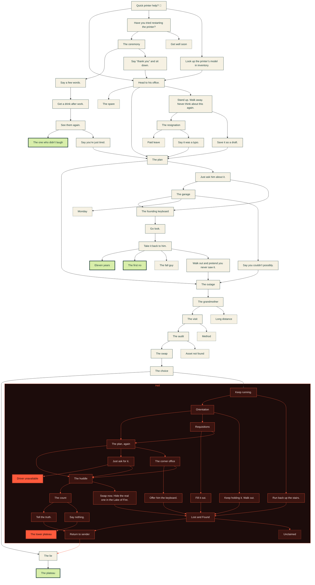

# Keyboard Heist: branch map

<!-- Generated by tools/branches.js from STORY in index.html. Do not edit by hand; rerun the script. -->

61 scenes, 6 real endings (solid green, or solid red in Hell), 9 dead ends (dashed). Red boxes are Hell.

[Open this flowchart in Mermaid Live](https://mermaid.live/view#base64:eyJjb2RlIjoiZmxvd2NoYXJ0IFREXG4gIGFycml2YWxbXCJRdWljayBwcmludGVyIGhlbHA/IPCfmYJcIl06OjpzY2VuZVxuICBvZmZpY2VbXCJIZWFkIHRvIGhpcyBvZmZpY2UuXCJdOjo6c2NlbmVcbiAgcGxhbltcIlRoZSBwbGFuXCJdOjo6c2NlbmVcbiAgb3V0YWdlW1wiVGhlIG91dGFnZVwiXTo6OnNjZW5lXG4gIGdyYW5kbW90aGVyW1wiVGhlIGdyYW5kbW90aGVyXCJdOjo6c2NlbmVcbiAgdmlzaXRbXCJUaGUgdmlzaXRcIl06OjpzY2VuZVxuICBhdWRpdFtcIlRoZSBhdWRpdFwiXTo6OnNjZW5lXG4gIHN3YXBbXCJUaGUgc3dhcFwiXTo6OnNjZW5lXG4gIGNob2ljZVtcIlRoZSBjaG9pY2VcIl06OjpzY2VuZVxuICBsaWVbXCJUaGUgbGllXCJdOjo6c2NlbmVcbiAgZW5kX3BsYXRlYXVbXCJUaGUgcGxhdGVhdVwiXTo6OmZpbmFsZVxuICBlbmRfc3BhcmVbXCJUaGUgc3BhcmVcIl06OjpkZWFkXG4gIGVuZF9tb21bXCJMb25nIGRpc3RhbmNlXCJdOjo6ZGVhZFxuICBlbmRfbWV0aG9kW1wiTWV0aG9kXCJdOjo6ZGVhZFxuICBlbmRfcmVkW1wiQXNzZXQgbm90IGZvdW5kXCJdOjo6ZGVhZFxuICByZXN0YXJ0W1wiSGF2ZSB5b3UgdHJpZWQgcmVzdGFydGluZyB0aGUgcHJpbnRlcj9cIl06OjpzY2VuZVxuICBjZXJlbW9ueVtcIlRoZSBjZXJlbW9ueVwiXTo6OnNjZW5lXG4gIGVuZF9zaWNrW1wiR2V0IHdlbGwgc29vblwiXTo6OmRlYWRcbiAgZW5kX3NwZWVjaFtcIlNheSBhIGZldyB3b3Jkcy5cIl06OjpzY2VuZVxuICB3YWxrX2F3YXlbXCJTdGFuZCB1cC4gV2FsayBhd2F5LiBOZXZlciB0aGluayBhYm91dCB0aGlzIGFnYWluLlwiXTo6OnNjZW5lXG4gIHJlc2lnbmVkW1wiVGhlIHJlc2lnbmF0aW9uXCJdOjo6c2NlbmVcbiAgZW5kX3NhYmJhdGljYWxbXCJQYWlkIGxlYXZlXCJdOjo6ZGVhZFxuICBhc2tbXCJKdXN0IGFzayBoaW0gYWJvdXQgaXQuXCJdOjo6c2NlbmVcbiAgZ2FyYWdlW1wiVGhlIGdhcmFnZVwiXTo6OnNjZW5lXG4gIGVuZF9mb3VuZGluZ1tcIlRoZSBmb3VuZGluZyBrZXlib2FyZFwiXTo6OnNjZW5lXG4gIGVuZF9ib3Jyb3dlZFtcIk1vbmRheVwiXTo6OmRlYWRcbiAgcHJpbnRlcl9tb2RlbFtcIkxvb2sgdXAgdGhlIHByaW50ZXLigJlzIG1vZGVsIGluIGludmVudG9yeS5cIl06OjpzY2VuZVxuICBsZW1vbltcIlNheSDigJx0aGFuayB5b3XigJ0gYW5kIHNpdCBkb3duLlwiXTo6OnNjZW5lXG4gIGRyYWZ0W1wiU2F2ZSBpdCBhcyBhIGRyYWZ0LlwiXTo6OnNjZW5lXG4gIHR5cG9bXCJTYXkgaXQgd2FzIGEgdHlwby5cIl06OjpzY2VuZVxuICBkZWNsaW5lZFtcIlNheSB5b3UgY291bGRu4oCZdCBwb3NzaWJseS5cIl06OjpzY2VuZVxuICBpbnZvaWNlc1tcIkdvIGxvb2suXCJdOjo6c2NlbmVcbiAgd2l6YXJkW1wiVGFrZSBpdCBiYWNrIHRvIGhpbS5cIl06OjpzY2VuZVxuICBlbmRfd2l6YXJkW1wiRWxldmVuIHllYXJzXCJdOjo6ZmluYWxlXG4gIHJlZnVzZVtcIlRoZSBmaXJzdCBub1wiXTo6OmZpbmFsZVxuICBlbmRfcmVwb3J0W1wiVGhlIGZhbGwgZ3V5XCJdOjo6ZGVhZFxuICBwcmV0ZW5kW1wiV2FsayBvdXQgYW5kIHByZXRlbmQgeW91IG5ldmVyIHNhdyBpdC5cIl06OjpzY2VuZVxuICBqb3JkYW5fZHJpbmtbXCJHZXQgYSBkcmluayBhZnRlciB3b3JrLlwiXTo6OnNjZW5lXG4gIGpvcmRhbl93ZWVrc1tcIlNlZSB0aGVtIGFnYWluLlwiXTo6OnNjZW5lXG4gIGpvcmRhbl90b2dldGhlcltcIlRoZSBvbmUgd2hvIGRpZG7igJl0IGxhdWdoXCJdOjo6ZmluYWxlXG4gIGpvcmRhbl9icmVha3VwW1wiU2F5IHlvdeKAmXJlIGp1c3QgdGlyZWQuXCJdOjo6c2NlbmVcbiAgc3ViZ3JhcGggSEVMTFtcIkhlbGxcIl1cbiAgICBlbmRfcnVubmluZ1tcIktlZXAgcnVubmluZy5cIl06OjpoZWxsU2NlbmVcbiAgICBoZWxsX3Vwc3RhaXJzW1wiUnVuIGJhY2sgdXAgdGhlIHN0YWlycy5cIl06OjpoZWxsU2NlbmVcbiAgICBoZWxsX29yaWVudGF0aW9uW1wiT3JpZW50YXRpb25cIl06OjpoZWxsU2NlbmVcbiAgICBoZWxsX2dyYWJbXCJLZWVwIGhvbGRpbmcgaXQuIFdhbGsgb3V0LlwiXTo6OmhlbGxTY2VuZVxuICAgIGhlbGxfcmVxdWlzaXRpb25bXCJSZXF1aXNpdGlvbnNcIl06OjpoZWxsU2NlbmVcbiAgICBoZWxsX2Zvcm1bXCJGaWxsIGl0IG91dC5cIl06OjpoZWxsU2NlbmVcbiAgICBoZWxsX3BsYW5bXCJUaGUgcGxhbiwgYWdhaW5cIl06OjpoZWxsU2NlbmVcbiAgICBoZWxsX2Fza1tcIkp1c3QgYXNrIGZvciBpdC5cIl06OjpoZWxsU2NlbmVcbiAgICBoZWxsX2pvYltcIkRyaXZlciB1bmF2YWlsYWJsZVwiXTo6OmhlbGxGaW5hbGVcbiAgICBoZWxsX2RldmlsW1wiVGhlIGNvcm5lciBvZmZpY2VcIl06OjpoZWxsU2NlbmVcbiAgICBoZWxsX3RyYWRlW1wiT2ZmZXIgaGltIHRoZSBrZXlib2FyZC5cIl06OjpoZWxsU2NlbmVcbiAgICBoZWxsX2h1ZGRsZVtcIlRoZSBodWRkbGVcIl06OjpoZWxsU2NlbmVcbiAgICBoZWxsX2xha2VbXCJTd2FwIG5vdy4gSGlkZSB0aGUgcmVhbCBvbmUgaW4gdGhlIExha2Ugb2YgRmlyZS5cIl06OjpoZWxsU2NlbmVcbiAgICBoZWxsX2NvdW50W1wiVGhlIGNvdW50XCJdOjo6aGVsbFNjZW5lXG4gICAgaGVsbF90cnV0aFtcIlRlbGwgdGhlIHRydXRoLlwiXTo6OmhlbGxTY2VuZVxuICAgIGhlbGxfcXVpZXRbXCJTYXkgbm90aGluZy5cIl06OjpoZWxsU2NlbmVcbiAgICBoZWxsX3BsYXRlYXVbXCJUaGUgbG93ZXIgcGxhdGVhdVwiXTo6OmhlbGxGaW5hbGVcbiAgICBoZWxsX2xvc3RbXCJMb3N0IGFuZCBGb3VuZFwiXTo6OmhlbGxTY2VuZVxuICAgIGhlbGxfcmV0dXJuW1wiUmV0dXJuIHRvIHNlbmRlclwiXTo6OmhlbGxTY2VuZVxuICAgIGhlbGxfdGFibGVbXCJVbmNsYWltZWRcIl06OjpoZWxsRGVhZFxuICBlbmRcbiAgYXJyaXZhbCAtLT4gb2ZmaWNlXG4gIGFycml2YWwgLS0+IHJlc3RhcnRcbiAgYXJyaXZhbCAtLT4gcHJpbnRlcl9tb2RlbFxuICBvZmZpY2UgLS0+IGVuZF9zcGFyZVxuICBvZmZpY2UgLS0+IHBsYW5cbiAgb2ZmaWNlIC0tPiB3YWxrX2F3YXlcbiAgcGxhbiAtLT4gb3V0YWdlXG4gIHBsYW4gLS0+IGFza1xuICBvdXRhZ2UgLS0+IGdyYW5kbW90aGVyXG4gIGdyYW5kbW90aGVyIC0tPiB2aXNpdFxuICBncmFuZG1vdGhlciAtLT4gZW5kX21vbVxuICB2aXNpdCAtLT4gYXVkaXRcbiAgdmlzaXQgLS0+IGVuZF9tZXRob2RcbiAgYXVkaXQgLS0+IHN3YXBcbiAgYXVkaXQgLS0+IGVuZF9yZWRcbiAgc3dhcCAtLT4gY2hvaWNlXG4gIGNob2ljZSAtLT4gbGllXG4gIGNob2ljZSAtLT4gZW5kX3J1bm5pbmdcbiAgbGllIC0tPiBlbmRfcGxhdGVhdVxuICBlbmRfcnVubmluZyAtLT4gaGVsbF9vcmllbnRhdGlvblxuICBlbmRfcnVubmluZyAtLT4gaGVsbF91cHN0YWlyc1xuICBoZWxsX3Vwc3RhaXJzIC0tPiBoZWxsX2xvc3RcbiAgaGVsbF9vcmllbnRhdGlvbiAtLT4gaGVsbF9wbGFuXG4gIGhlbGxfb3JpZW50YXRpb24gLS0+IGhlbGxfcmVxdWlzaXRpb25cbiAgaGVsbF9vcmllbnRhdGlvbiAtLT4gaGVsbF9ncmFiXG4gIGhlbGxfZ3JhYiAtLT4gaGVsbF9sb3N0XG4gIGhlbGxfcmVxdWlzaXRpb24gLS0+IGhlbGxfZm9ybVxuICBoZWxsX3JlcXVpc2l0aW9uIC0tPiBoZWxsX3BsYW5cbiAgaGVsbF9mb3JtIC0tPiBoZWxsX2xvc3RcbiAgaGVsbF9wbGFuIC0tPiBoZWxsX2h1ZGRsZVxuICBoZWxsX3BsYW4gLS0+IGhlbGxfYXNrXG4gIGhlbGxfcGxhbiAtLT4gaGVsbF9kZXZpbFxuICBoZWxsX2FzayAtLT4gaGVsbF9qb2JcbiAgaGVsbF9hc2sgLS0+IGhlbGxfaHVkZGxlXG4gIGhlbGxfZGV2aWwgLS0+IGhlbGxfdHJhZGVcbiAgaGVsbF9kZXZpbCAtLT4gaGVsbF9odWRkbGVcbiAgaGVsbF90cmFkZSAtLT4gaGVsbF9sb3N0XG4gIGhlbGxfaHVkZGxlIC0tPiBoZWxsX2NvdW50XG4gIGhlbGxfaHVkZGxlIC0tPiBoZWxsX2xha2VcbiAgaGVsbF9sYWtlIC0tPiBoZWxsX2xvc3RcbiAgaGVsbF9jb3VudCAtLT4gaGVsbF90cnV0aFxuICBoZWxsX2NvdW50IC0tPiBoZWxsX3F1aWV0XG4gIGhlbGxfdHJ1dGggLS0+IGhlbGxfcmV0dXJuXG4gIGhlbGxfcXVpZXQgLS0+IGhlbGxfcGxhdGVhdVxuICBoZWxsX2xvc3QgLS0+IGhlbGxfcmV0dXJuXG4gIGhlbGxfbG9zdCAtLT4gaGVsbF90YWJsZVxuICBoZWxsX3JldHVybiAtLT4gbGllXG4gIHJlc3RhcnQgLS0+IGNlcmVtb255XG4gIHJlc3RhcnQgLS0+IGVuZF9zaWNrXG4gIGNlcmVtb255IC0tPiBlbmRfc3BlZWNoXG4gIGNlcmVtb255IC0tPiBsZW1vblxuICBlbmRfc3BlZWNoIC0tPiBqb3JkYW5fZHJpbmtcbiAgd2Fsa19hd2F5IC0tPiByZXNpZ25lZFxuICB3YWxrX2F3YXkgLS0+IGRyYWZ0XG4gIHJlc2lnbmVkIC0tPiBlbmRfc2FiYmF0aWNhbFxuICByZXNpZ25lZCAtLT4gdHlwb1xuICBhc2sgLS0+IGdhcmFnZVxuICBhc2sgLS0+IGVuZF9mb3VuZGluZ1xuICBnYXJhZ2UgLS0+IGVuZF9mb3VuZGluZ1xuICBnYXJhZ2UgLS0+IGVuZF9ib3Jyb3dlZFxuICBnYXJhZ2UgLS0+IGRlY2xpbmVkXG4gIGVuZF9mb3VuZGluZyAtLT4gaW52b2ljZXNcbiAgcHJpbnRlcl9tb2RlbCAtLT4gb2ZmaWNlXG4gIGxlbW9uIC0tPiBvZmZpY2VcbiAgZHJhZnQgLS0+IHBsYW5cbiAgdHlwbyAtLT4gcGxhblxuICBkZWNsaW5lZCAtLT4gb3V0YWdlXG4gIGludm9pY2VzIC0tPiB3aXphcmRcbiAgd2l6YXJkIC0tPiBlbmRfd2l6YXJkXG4gIHdpemFyZCAtLT4gcmVmdXNlXG4gIHdpemFyZCAtLT4gZW5kX3JlcG9ydFxuICB3aXphcmQgLS0+IHByZXRlbmRcbiAgcHJldGVuZCAtLT4gb3V0YWdlXG4gIGpvcmRhbl9kcmluayAtLT4gam9yZGFuX3dlZWtzXG4gIGpvcmRhbl93ZWVrcyAtLT4gam9yZGFuX3RvZ2V0aGVyXG4gIGpvcmRhbl93ZWVrcyAtLT4gam9yZGFuX2JyZWFrdXBcbiAgam9yZGFuX2JyZWFrdXAgLS0+IHBsYW5cbiAgbGlua1N0eWxlIDE5LDIwLDIxLDIyLDIzLDI0LDI1LDI2LDI3LDI4LDI5LDMwLDMxLDMyLDMzLDM0LDM1LDM2LDM3LDM4LDM5LDQwLDQxLDQyLDQzLDQ0LDQ1LDQ2IHN0cm9rZTojZmY1YTNjXG4gIGNsYXNzRGVmIHNjZW5lIGZpbGw6I2Y2ZjFlMyxzdHJva2U6IzE5M2IzNyxjb2xvcjojMTkzYjM3XG4gIGNsYXNzRGVmIGZpbmFsZSBmaWxsOiNkOGVlYWEsc3Ryb2tlOiMxOTNiMzcsc3Ryb2tlLXdpZHRoOjNweCxjb2xvcjojMTkzYjM3XG4gIGNsYXNzRGVmIGRlYWQgZmlsbDojZjZmMWUzLHN0cm9rZTojMTkzYjM3LHN0cm9rZS1kYXNoYXJyYXk6NCAzLGNvbG9yOiMxOTNiMzdcbiAgY2xhc3NEZWYgaGVsbFNjZW5lIGZpbGw6IzNhMTQxMCxzdHJva2U6I2ZmNWEzYyxjb2xvcjojZjVlNmUyXG4gIGNsYXNzRGVmIGhlbGxGaW5hbGUgZmlsbDojZmY1YTNjLHN0cm9rZTojM2ExNDEwLHN0cm9rZS13aWR0aDozcHgsY29sb3I6IzFjMGMwYlxuICBjbGFzc0RlZiBoZWxsRGVhZCBmaWxsOiMzYTE0MTAsc3Ryb2tlOiNmZjVhM2Msc3Ryb2tlLWRhc2hhcnJheTo0IDMsY29sb3I6I2Y1ZTZlMlxuICBzdHlsZSBIRUxMIGZpbGw6IzFjMGMwYixzdHJva2U6I2ZmNWEzYyxjb2xvcjojZmY1YTNjIiwibWVybWFpZCI6IntcInRoZW1lXCI6XCJkZWZhdWx0XCJ9IiwiYXV0b1N5bmMiOnRydWUsInVwZGF0ZURpYWdyYW0iOnRydWV9) (zoom and pan; spoils the whole story).

## Every scene

Each link opens that scene in `index.html`.

| Scene | Kind | Leads to |
| --- | --- | --- |
| [Quick printer help? 🙂](index.html#L41) `arrival` | Scene | [`office`](index.html#L74), [`restart`](index.html#L751), [`printer_model`](index.html#L954) |
| [Head to his office.](index.html#L74) `office` | Scene | [`end_spare`](index.html#L293), [`plan`](index.html#L107), [`walk_away`](index.html#L821) |
| [The plan](index.html#L107) `plan` | Scene | [`outage`](index.html#L131), [`ask`](index.html#L877) |
| [The outage](index.html#L131) `outage` | Scene | [`grandmother`](index.html#L149) |
| [The grandmother](index.html#L149) `grandmother` | Scene | [`visit`](index.html#L173), [`end_mom`](index.html#L309) |
| [The visit](index.html#L173) `visit` | Scene | [`audit`](index.html#L196), [`end_method`](index.html#L321) |
| [The audit](index.html#L196) `audit` | Scene | [`swap`](index.html#L217), [`end_red`](index.html#L333) |
| [The swap](index.html#L217) `swap` | Scene | [`choice`](index.html#L235) |
| [The choice](index.html#L235) `choice` | Scene | [`lie`](index.html#L258), [`end_running`](index.html#L345) |
| [The lie](index.html#L258) `lie` | Scene | [`end_plateau`](index.html#L277) |
| [The plateau](index.html#L277) `end_plateau` | Real ending | (end) |
| [The spare](index.html#L293) `end_spare` | Dead end | (end) |
| [Long distance](index.html#L309) `end_mom` | Dead end | (end) |
| [Method](index.html#L321) `end_method` | Dead end | (end) |
| [Asset not found](index.html#L333) `end_red` | Dead end | (end) |
| [Keep running.](index.html#L345) `end_running` (Hell) | Scene | [`hell_orientation`](index.html#L387), [`hell_upstairs`](index.html#L369) |
| [Run back up the stairs.](index.html#L369) `hell_upstairs` (Hell) | Scene | [`hell_lost`](index.html#L699) |
| [Orientation](index.html#L387) `hell_orientation` (Hell) | Scene | [`hell_plan`](index.html#L475), [`hell_requisition`](index.html#L435), [`hell_grab`](index.html#L417) |
| [Keep holding it. Walk out.](index.html#L417) `hell_grab` (Hell) | Scene | [`hell_lost`](index.html#L699) |
| [Requisitions](index.html#L435) `hell_requisition` (Hell) | Scene | [`hell_form`](index.html#L457), [`hell_plan`](index.html#L475) |
| [Fill it out.](index.html#L457) `hell_form` (Hell) | Scene | [`hell_lost`](index.html#L699) |
| [The plan, again](index.html#L475) `hell_plan` (Hell) | Scene | [`hell_huddle`](index.html#L583), [`hell_ask`](index.html#L503), [`hell_devil`](index.html#L541) |
| [Just ask for it.](index.html#L503) `hell_ask` (Hell) | Scene | [`hell_job`](index.html#L526), [`hell_huddle`](index.html#L583) |
| [Driver unavailable](index.html#L526) `hell_job` (Hell) | Real ending | (end) |
| [The corner office](index.html#L541) `hell_devil` (Hell) | Scene | [`hell_trade`](index.html#L564), [`hell_huddle`](index.html#L583) |
| [Offer him the keyboard.](index.html#L564) `hell_trade` (Hell) | Scene | [`hell_lost`](index.html#L699) |
| [The huddle](index.html#L583) `hell_huddle` (Hell) | Scene | [`hell_count`](index.html#L624), [`hell_lake`](index.html#L606) |
| [Swap now. Hide the real one in the Lake of Fire.](index.html#L606) `hell_lake` (Hell) | Scene | [`hell_lost`](index.html#L699) |
| [The count](index.html#L624) `hell_count` (Hell) | Scene | [`hell_truth`](index.html#L648), [`hell_quiet`](index.html#L666) |
| [Tell the truth.](index.html#L648) `hell_truth` (Hell) | Scene | [`hell_return`](index.html#L722) |
| [Say nothing.](index.html#L666) `hell_quiet` (Hell) | Scene | [`hell_plateau`](index.html#L684) |
| [The lower plateau](index.html#L684) `hell_plateau` (Hell) | Real ending | (end) |
| [Lost and Found](index.html#L699) `hell_lost` (Hell) | Scene | [`hell_return`](index.html#L722), [`hell_table`](index.html#L739) |
| [Return to sender](index.html#L722) `hell_return` (Hell) | Scene | [`lie`](index.html#L258) |
| [Unclaimed](index.html#L739) `hell_table` (Hell) | Dead end | (end) |
| [Have you tried restarting the printer?](index.html#L751) `restart` | Scene | [`ceremony`](index.html#L773), [`end_sick`](index.html#L794) |
| [The ceremony](index.html#L773) `ceremony` | Scene | [`end_speech`](index.html#L804), [`lemon`](index.html#L970) |
| [Get well soon](index.html#L794) `end_sick` | Dead end | (end) |
| [Say a few words.](index.html#L804) `end_speech` | Scene | [`jordan_drink`](index.html#L1150) |
| [Stand up. Walk away. Never think about this again.](index.html#L821) `walk_away` | Scene | [`resigned`](index.html#L843), [`draft`](index.html#L986) |
| [The resignation](index.html#L843) `resigned` | Scene | [`end_sabbatical`](index.html#L866), [`typo`](index.html#L1001) |
| [Paid leave](index.html#L866) `end_sabbatical` | Dead end | (end) |
| [Just ask him about it.](index.html#L877) `ask` | Scene | [`garage`](index.html#L899), [`end_founding`](index.html#L925) |
| [The garage](index.html#L899) `garage` | Scene | [`end_founding`](index.html#L925), [`end_borrowed`](index.html#L942), [`declined`](index.html#L1018) |
| [The founding keyboard](index.html#L925) `end_founding` | Scene | [`invoices`](index.html#L1035) |
| [Monday](index.html#L942) `end_borrowed` | Dead end | (end) |
| [Look up the printer’s model in inventory.](index.html#L954) `printer_model` | Scene | [`office`](index.html#L74) |
| [Say “thank you” and sit down.](index.html#L970) `lemon` | Scene | [`office`](index.html#L74) |
| [Save it as a draft.](index.html#L986) `draft` | Scene | [`plan`](index.html#L107) |
| [Say it was a typo.](index.html#L1001) `typo` | Scene | [`plan`](index.html#L107) |
| [Say you couldn’t possibly.](index.html#L1018) `declined` | Scene | [`outage`](index.html#L131) |
| [Go look.](index.html#L1035) `invoices` | Scene | [`wizard`](index.html#L1053) |
| [Take it back to him.](index.html#L1053) `wizard` | Scene | [`end_wizard`](index.html#L1087), [`refuse`](index.html#L1103), [`end_report`](index.html#L1119), [`pretend`](index.html#L1133) |
| [Eleven years](index.html#L1087) `end_wizard` | Real ending | (end) |
| [The first no](index.html#L1103) `refuse` | Real ending | (end) |
| [The fall guy](index.html#L1119) `end_report` | Dead end | (end) |
| [Walk out and pretend you never saw it.](index.html#L1133) `pretend` | Scene | [`outage`](index.html#L131) |
| [Get a drink after work.](index.html#L1150) `jordan_drink` | Scene | [`jordan_weeks`](index.html#L1168) |
| [See them again.](index.html#L1168) `jordan_weeks` | Scene | [`jordan_together`](index.html#L1190), [`jordan_breakup`](index.html#L1205) |
| [The one who didn’t laugh](index.html#L1190) `jordan_together` | Real ending | (end) |
| [Say you’re just tired.](index.html#L1205) `jordan_breakup` | Scene | [`plan`](index.html#L107) |
