# Keyboard Heist: branch map

<!-- Generated by tools/branches.js from STORY in index.html. Do not edit by hand; rerun the script. -->

59 scenes, 12 real endings (solid green, or solid red in Hell), 8 dead ends (dashed diamonds). Red boxes are Hell.

```mermaid
flowchart TD
  arrival["Quick printer help? 🙂"]:::scene
  office["Head to his office."]:::scene
  plan["The plan"]:::scene
  outage["The outage"]:::scene
  grandmother["The grandmother"]:::scene
  visit["The visit"]:::scene
  audit["The audit"]:::scene
  swap["The swap"]:::scene
  choice["The choice"]:::scene
  lie["The lie"]:::scene
  end_plateau["The plateau"]:::finale
  end_spare{"The spare"}:::dead
  end_mom{"Long distance"}:::dead
  end_method{"Method"}:::dead
  end_red{"Asset not found"}:::dead
  restart["Have you tried restarting the printer?"]:::scene
  ceremony["The ceremony"]:::scene
  end_sick{"Get well soon"}:::dead
  end_speech["Say a few words."]:::scene
  walk_away["Stand up. Walk away. Never think about this again."]:::scene
  resigned["The resignation"]:::scene
  end_sabbatical{"Paid leave"}:::dead
  ask["Just ask him about it."]:::scene
  garage["The garage"]:::scene
  end_founding["The founding keyboard"]:::scene
  end_borrowed{"Monday"}:::dead
  printer_model["Look up the printer’s model in inventory."]:::scene
  lemon["Say “thank you” and sit down."]:::scene
  draft["Save it as a draft."]:::scene
  typo["Say it was a typo."]:::scene
  declined["Say you couldn’t possibly."]:::scene
  invoices["Go look."]:::scene
  wizard["Take it back to him."]:::scene
  end_wizard["Eleven years"]:::finale
  refuse["The first no"]:::finale
  end_report{"The fall guy"}:::dead
  pretend["Walk out and pretend you never saw it."]:::scene
  jordan_drink["Get a drink after work."]:::scene
  jordan_weeks["See them again."]:::scene
  jordan_together["The one who didn’t laugh"]:::finale
  jordan_breakup["Say you’re just tired."]:::scene
  subgraph HELL["Hell"]
    end_running["Keep running."]:::hellScene
    hell_upstairs["Not the hero"]:::hellFinale
    hell_orientation["Orientation"]:::hellScene
    hell_grab["Keep holding it. Walk out."]:::hellScene
    hell_committee["The committee"]:::hellFinale
    hell_quiet["Say nothing."]:::hellScene
    hell_form["Pending"]:::hellFinale
    hell_devil["The corner office"]:::hellScene
    hell_job["Driver unavailable"]:::hellFinale
    hell_plateau["The lower plateau"]:::hellFinale
    hell_plan["The plan, again"]:::hellScene
    hell_lake["Lost and found"]:::hellFinale
    hell_ask["Just ask for it."]:::hellScene
    hell_count["The count"]:::hellFinale
    hell_offer["The Devil’s offer"]:::hellScene
    hell_trade["Fair trade"]:::hellFinale
    hell_truth["Say no."]:::hellScene
    hell_return["Return to sender"]:::hellScene
  end
  arrival --> office
  arrival --> restart
  arrival --> printer_model
  office --> end_spare
  office --> plan
  office --> walk_away
  plan --> outage
  plan --> ask
  outage --> grandmother
  grandmother --> visit
  grandmother --> end_mom
  visit --> audit
  visit --> end_method
  audit --> swap
  audit --> end_red
  swap --> choice
  choice --> lie
  choice --> end_running
  lie --> end_plateau
  end_running --> hell_orientation
  end_running --> hell_upstairs
  hell_orientation --> hell_grab
  hell_orientation --> hell_plan
  hell_grab --> hell_quiet
  hell_grab --> hell_committee
  hell_quiet --> hell_devil
  hell_quiet --> hell_form
  hell_devil --> hell_job
  hell_devil --> hell_plateau
  hell_plan --> hell_lake
  hell_plan --> hell_ask
  hell_ask --> hell_count
  hell_ask --> hell_offer
  hell_offer --> hell_trade
  hell_offer --> hell_truth
  hell_truth --> hell_return
  hell_return --> lie
  restart --> ceremony
  restart --> end_sick
  ceremony --> end_speech
  ceremony --> lemon
  end_speech --> jordan_drink
  walk_away --> resigned
  walk_away --> draft
  resigned --> end_sabbatical
  resigned --> typo
  ask --> garage
  ask --> end_founding
  garage --> end_founding
  garage --> end_borrowed
  garage --> declined
  end_founding --> invoices
  printer_model --> office
  lemon --> office
  draft --> plan
  typo --> plan
  declined --> outage
  invoices --> wizard
  wizard --> end_wizard
  wizard --> refuse
  wizard --> end_report
  wizard --> pretend
  pretend --> outage
  jordan_drink --> jordan_weeks
  jordan_weeks --> jordan_together
  jordan_weeks --> jordan_breakup
  jordan_breakup --> plan
  linkStyle 19,20,21,22,23,24,25,26,27,28,29,30,31,32,33,34,35,36 stroke:#ff5a3c
  classDef scene fill:#f6f1e3,stroke:#193b37,color:#193b37
  classDef finale fill:#d8eeaa,stroke:#193b37,stroke-width:3px,color:#193b37
  classDef dead fill:#f6f1e3,stroke:#193b37,stroke-dasharray:4 3,color:#193b37
  classDef hellScene fill:#3a1410,stroke:#ff5a3c,color:#f5e6e2
  classDef hellFinale fill:#ff5a3c,stroke:#3a1410,stroke-width:3px,color:#1c0c0b
  classDef hellDead fill:#3a1410,stroke:#ff5a3c,stroke-dasharray:4 3,color:#f5e6e2
  style HELL fill:#1c0c0b,stroke:#ff5a3c,color:#ff5a3c
```

[Open this flowchart in Mermaid Live](https://mermaid.live/view#base64:eyJjb2RlIjoiZmxvd2NoYXJ0IFREXG4gIGFycml2YWxbXCJRdWljayBwcmludGVyIGhlbHA/IPCfmYJcIl06OjpzY2VuZVxuICBvZmZpY2VbXCJIZWFkIHRvIGhpcyBvZmZpY2UuXCJdOjo6c2NlbmVcbiAgcGxhbltcIlRoZSBwbGFuXCJdOjo6c2NlbmVcbiAgb3V0YWdlW1wiVGhlIG91dGFnZVwiXTo6OnNjZW5lXG4gIGdyYW5kbW90aGVyW1wiVGhlIGdyYW5kbW90aGVyXCJdOjo6c2NlbmVcbiAgdmlzaXRbXCJUaGUgdmlzaXRcIl06OjpzY2VuZVxuICBhdWRpdFtcIlRoZSBhdWRpdFwiXTo6OnNjZW5lXG4gIHN3YXBbXCJUaGUgc3dhcFwiXTo6OnNjZW5lXG4gIGNob2ljZVtcIlRoZSBjaG9pY2VcIl06OjpzY2VuZVxuICBsaWVbXCJUaGUgbGllXCJdOjo6c2NlbmVcbiAgZW5kX3BsYXRlYXVbXCJUaGUgcGxhdGVhdVwiXTo6OmZpbmFsZVxuICBlbmRfc3BhcmV7XCJUaGUgc3BhcmVcIn06OjpkZWFkXG4gIGVuZF9tb217XCJMb25nIGRpc3RhbmNlXCJ9Ojo6ZGVhZFxuICBlbmRfbWV0aG9ke1wiTWV0aG9kXCJ9Ojo6ZGVhZFxuICBlbmRfcmVke1wiQXNzZXQgbm90IGZvdW5kXCJ9Ojo6ZGVhZFxuICByZXN0YXJ0W1wiSGF2ZSB5b3UgdHJpZWQgcmVzdGFydGluZyB0aGUgcHJpbnRlcj9cIl06OjpzY2VuZVxuICBjZXJlbW9ueVtcIlRoZSBjZXJlbW9ueVwiXTo6OnNjZW5lXG4gIGVuZF9zaWNre1wiR2V0IHdlbGwgc29vblwifTo6OmRlYWRcbiAgZW5kX3NwZWVjaFtcIlNheSBhIGZldyB3b3Jkcy5cIl06OjpzY2VuZVxuICB3YWxrX2F3YXlbXCJTdGFuZCB1cC4gV2FsayBhd2F5LiBOZXZlciB0aGluayBhYm91dCB0aGlzIGFnYWluLlwiXTo6OnNjZW5lXG4gIHJlc2lnbmVkW1wiVGhlIHJlc2lnbmF0aW9uXCJdOjo6c2NlbmVcbiAgZW5kX3NhYmJhdGljYWx7XCJQYWlkIGxlYXZlXCJ9Ojo6ZGVhZFxuICBhc2tbXCJKdXN0IGFzayBoaW0gYWJvdXQgaXQuXCJdOjo6c2NlbmVcbiAgZ2FyYWdlW1wiVGhlIGdhcmFnZVwiXTo6OnNjZW5lXG4gIGVuZF9mb3VuZGluZ1tcIlRoZSBmb3VuZGluZyBrZXlib2FyZFwiXTo6OnNjZW5lXG4gIGVuZF9ib3Jyb3dlZHtcIk1vbmRheVwifTo6OmRlYWRcbiAgcHJpbnRlcl9tb2RlbFtcIkxvb2sgdXAgdGhlIHByaW50ZXLigJlzIG1vZGVsIGluIGludmVudG9yeS5cIl06OjpzY2VuZVxuICBsZW1vbltcIlNheSDigJx0aGFuayB5b3XigJ0gYW5kIHNpdCBkb3duLlwiXTo6OnNjZW5lXG4gIGRyYWZ0W1wiU2F2ZSBpdCBhcyBhIGRyYWZ0LlwiXTo6OnNjZW5lXG4gIHR5cG9bXCJTYXkgaXQgd2FzIGEgdHlwby5cIl06OjpzY2VuZVxuICBkZWNsaW5lZFtcIlNheSB5b3UgY291bGRu4oCZdCBwb3NzaWJseS5cIl06OjpzY2VuZVxuICBpbnZvaWNlc1tcIkdvIGxvb2suXCJdOjo6c2NlbmVcbiAgd2l6YXJkW1wiVGFrZSBpdCBiYWNrIHRvIGhpbS5cIl06OjpzY2VuZVxuICBlbmRfd2l6YXJkW1wiRWxldmVuIHllYXJzXCJdOjo6ZmluYWxlXG4gIHJlZnVzZVtcIlRoZSBmaXJzdCBub1wiXTo6OmZpbmFsZVxuICBlbmRfcmVwb3J0e1wiVGhlIGZhbGwgZ3V5XCJ9Ojo6ZGVhZFxuICBwcmV0ZW5kW1wiV2FsayBvdXQgYW5kIHByZXRlbmQgeW91IG5ldmVyIHNhdyBpdC5cIl06OjpzY2VuZVxuICBqb3JkYW5fZHJpbmtbXCJHZXQgYSBkcmluayBhZnRlciB3b3JrLlwiXTo6OnNjZW5lXG4gIGpvcmRhbl93ZWVrc1tcIlNlZSB0aGVtIGFnYWluLlwiXTo6OnNjZW5lXG4gIGpvcmRhbl90b2dldGhlcltcIlRoZSBvbmUgd2hvIGRpZG7igJl0IGxhdWdoXCJdOjo6ZmluYWxlXG4gIGpvcmRhbl9icmVha3VwW1wiU2F5IHlvdeKAmXJlIGp1c3QgdGlyZWQuXCJdOjo6c2NlbmVcbiAgc3ViZ3JhcGggSEVMTFtcIkhlbGxcIl1cbiAgICBlbmRfcnVubmluZ1tcIktlZXAgcnVubmluZy5cIl06OjpoZWxsU2NlbmVcbiAgICBoZWxsX3Vwc3RhaXJzW1wiTm90IHRoZSBoZXJvXCJdOjo6aGVsbEZpbmFsZVxuICAgIGhlbGxfb3JpZW50YXRpb25bXCJPcmllbnRhdGlvblwiXTo6OmhlbGxTY2VuZVxuICAgIGhlbGxfZ3JhYltcIktlZXAgaG9sZGluZyBpdC4gV2FsayBvdXQuXCJdOjo6aGVsbFNjZW5lXG4gICAgaGVsbF9jb21taXR0ZWVbXCJUaGUgY29tbWl0dGVlXCJdOjo6aGVsbEZpbmFsZVxuICAgIGhlbGxfcXVpZXRbXCJTYXkgbm90aGluZy5cIl06OjpoZWxsU2NlbmVcbiAgICBoZWxsX2Zvcm1bXCJQZW5kaW5nXCJdOjo6aGVsbEZpbmFsZVxuICAgIGhlbGxfZGV2aWxbXCJUaGUgY29ybmVyIG9mZmljZVwiXTo6OmhlbGxTY2VuZVxuICAgIGhlbGxfam9iW1wiRHJpdmVyIHVuYXZhaWxhYmxlXCJdOjo6aGVsbEZpbmFsZVxuICAgIGhlbGxfcGxhdGVhdVtcIlRoZSBsb3dlciBwbGF0ZWF1XCJdOjo6aGVsbEZpbmFsZVxuICAgIGhlbGxfcGxhbltcIlRoZSBwbGFuLCBhZ2FpblwiXTo6OmhlbGxTY2VuZVxuICAgIGhlbGxfbGFrZVtcIkxvc3QgYW5kIGZvdW5kXCJdOjo6aGVsbEZpbmFsZVxuICAgIGhlbGxfYXNrW1wiSnVzdCBhc2sgZm9yIGl0LlwiXTo6OmhlbGxTY2VuZVxuICAgIGhlbGxfY291bnRbXCJUaGUgY291bnRcIl06OjpoZWxsRmluYWxlXG4gICAgaGVsbF9vZmZlcltcIlRoZSBEZXZpbOKAmXMgb2ZmZXJcIl06OjpoZWxsU2NlbmVcbiAgICBoZWxsX3RyYWRlW1wiRmFpciB0cmFkZVwiXTo6OmhlbGxGaW5hbGVcbiAgICBoZWxsX3RydXRoW1wiU2F5IG5vLlwiXTo6OmhlbGxTY2VuZVxuICAgIGhlbGxfcmV0dXJuW1wiUmV0dXJuIHRvIHNlbmRlclwiXTo6OmhlbGxTY2VuZVxuICBlbmRcbiAgYXJyaXZhbCAtLT4gb2ZmaWNlXG4gIGFycml2YWwgLS0+IHJlc3RhcnRcbiAgYXJyaXZhbCAtLT4gcHJpbnRlcl9tb2RlbFxuICBvZmZpY2UgLS0+IGVuZF9zcGFyZVxuICBvZmZpY2UgLS0+IHBsYW5cbiAgb2ZmaWNlIC0tPiB3YWxrX2F3YXlcbiAgcGxhbiAtLT4gb3V0YWdlXG4gIHBsYW4gLS0+IGFza1xuICBvdXRhZ2UgLS0+IGdyYW5kbW90aGVyXG4gIGdyYW5kbW90aGVyIC0tPiB2aXNpdFxuICBncmFuZG1vdGhlciAtLT4gZW5kX21vbVxuICB2aXNpdCAtLT4gYXVkaXRcbiAgdmlzaXQgLS0+IGVuZF9tZXRob2RcbiAgYXVkaXQgLS0+IHN3YXBcbiAgYXVkaXQgLS0+IGVuZF9yZWRcbiAgc3dhcCAtLT4gY2hvaWNlXG4gIGNob2ljZSAtLT4gbGllXG4gIGNob2ljZSAtLT4gZW5kX3J1bm5pbmdcbiAgbGllIC0tPiBlbmRfcGxhdGVhdVxuICBlbmRfcnVubmluZyAtLT4gaGVsbF9vcmllbnRhdGlvblxuICBlbmRfcnVubmluZyAtLT4gaGVsbF91cHN0YWlyc1xuICBoZWxsX29yaWVudGF0aW9uIC0tPiBoZWxsX2dyYWJcbiAgaGVsbF9vcmllbnRhdGlvbiAtLT4gaGVsbF9wbGFuXG4gIGhlbGxfZ3JhYiAtLT4gaGVsbF9xdWlldFxuICBoZWxsX2dyYWIgLS0+IGhlbGxfY29tbWl0dGVlXG4gIGhlbGxfcXVpZXQgLS0+IGhlbGxfZGV2aWxcbiAgaGVsbF9xdWlldCAtLT4gaGVsbF9mb3JtXG4gIGhlbGxfZGV2aWwgLS0+IGhlbGxfam9iXG4gIGhlbGxfZGV2aWwgLS0+IGhlbGxfcGxhdGVhdVxuICBoZWxsX3BsYW4gLS0+IGhlbGxfbGFrZVxuICBoZWxsX3BsYW4gLS0+IGhlbGxfYXNrXG4gIGhlbGxfYXNrIC0tPiBoZWxsX2NvdW50XG4gIGhlbGxfYXNrIC0tPiBoZWxsX29mZmVyXG4gIGhlbGxfb2ZmZXIgLS0+IGhlbGxfdHJhZGVcbiAgaGVsbF9vZmZlciAtLT4gaGVsbF90cnV0aFxuICBoZWxsX3RydXRoIC0tPiBoZWxsX3JldHVyblxuICBoZWxsX3JldHVybiAtLT4gbGllXG4gIHJlc3RhcnQgLS0+IGNlcmVtb255XG4gIHJlc3RhcnQgLS0+IGVuZF9zaWNrXG4gIGNlcmVtb255IC0tPiBlbmRfc3BlZWNoXG4gIGNlcmVtb255IC0tPiBsZW1vblxuICBlbmRfc3BlZWNoIC0tPiBqb3JkYW5fZHJpbmtcbiAgd2Fsa19hd2F5IC0tPiByZXNpZ25lZFxuICB3YWxrX2F3YXkgLS0+IGRyYWZ0XG4gIHJlc2lnbmVkIC0tPiBlbmRfc2FiYmF0aWNhbFxuICByZXNpZ25lZCAtLT4gdHlwb1xuICBhc2sgLS0+IGdhcmFnZVxuICBhc2sgLS0+IGVuZF9mb3VuZGluZ1xuICBnYXJhZ2UgLS0+IGVuZF9mb3VuZGluZ1xuICBnYXJhZ2UgLS0+IGVuZF9ib3Jyb3dlZFxuICBnYXJhZ2UgLS0+IGRlY2xpbmVkXG4gIGVuZF9mb3VuZGluZyAtLT4gaW52b2ljZXNcbiAgcHJpbnRlcl9tb2RlbCAtLT4gb2ZmaWNlXG4gIGxlbW9uIC0tPiBvZmZpY2VcbiAgZHJhZnQgLS0+IHBsYW5cbiAgdHlwbyAtLT4gcGxhblxuICBkZWNsaW5lZCAtLT4gb3V0YWdlXG4gIGludm9pY2VzIC0tPiB3aXphcmRcbiAgd2l6YXJkIC0tPiBlbmRfd2l6YXJkXG4gIHdpemFyZCAtLT4gcmVmdXNlXG4gIHdpemFyZCAtLT4gZW5kX3JlcG9ydFxuICB3aXphcmQgLS0+IHByZXRlbmRcbiAgcHJldGVuZCAtLT4gb3V0YWdlXG4gIGpvcmRhbl9kcmluayAtLT4gam9yZGFuX3dlZWtzXG4gIGpvcmRhbl93ZWVrcyAtLT4gam9yZGFuX3RvZ2V0aGVyXG4gIGpvcmRhbl93ZWVrcyAtLT4gam9yZGFuX2JyZWFrdXBcbiAgam9yZGFuX2JyZWFrdXAgLS0+IHBsYW5cbiAgbGlua1N0eWxlIDE5LDIwLDIxLDIyLDIzLDI0LDI1LDI2LDI3LDI4LDI5LDMwLDMxLDMyLDMzLDM0LDM1LDM2IHN0cm9rZTojZmY1YTNjXG4gIGNsYXNzRGVmIHNjZW5lIGZpbGw6I2Y2ZjFlMyxzdHJva2U6IzE5M2IzNyxjb2xvcjojMTkzYjM3XG4gIGNsYXNzRGVmIGZpbmFsZSBmaWxsOiNkOGVlYWEsc3Ryb2tlOiMxOTNiMzcsc3Ryb2tlLXdpZHRoOjNweCxjb2xvcjojMTkzYjM3XG4gIGNsYXNzRGVmIGRlYWQgZmlsbDojZjZmMWUzLHN0cm9rZTojMTkzYjM3LHN0cm9rZS1kYXNoYXJyYXk6NCAzLGNvbG9yOiMxOTNiMzdcbiAgY2xhc3NEZWYgaGVsbFNjZW5lIGZpbGw6IzNhMTQxMCxzdHJva2U6I2ZmNWEzYyxjb2xvcjojZjVlNmUyXG4gIGNsYXNzRGVmIGhlbGxGaW5hbGUgZmlsbDojZmY1YTNjLHN0cm9rZTojM2ExNDEwLHN0cm9rZS13aWR0aDozcHgsY29sb3I6IzFjMGMwYlxuICBjbGFzc0RlZiBoZWxsRGVhZCBmaWxsOiMzYTE0MTAsc3Ryb2tlOiNmZjVhM2Msc3Ryb2tlLWRhc2hhcnJheTo0IDMsY29sb3I6I2Y1ZTZlMlxuICBzdHlsZSBIRUxMIGZpbGw6IzFjMGMwYixzdHJva2U6I2ZmNWEzYyxjb2xvcjojZmY1YTNjIiwibWVybWFpZCI6IntcInRoZW1lXCI6XCJkZWZhdWx0XCJ9IiwiYXV0b1N5bmMiOnRydWUsInVwZGF0ZURpYWdyYW0iOnRydWV9) (zoom and pan; spoils the whole story).

## Every scene

Each link opens that scene in `index.html`.

| Scene | Kind | Leads to |
| --- | --- | --- |
| [Quick printer help? 🙂](index.html#L41) `arrival` | Scene | [`office`](index.html#L74), [`restart`](index.html#L706), [`printer_model`](index.html#L909) |
| [Head to his office.](index.html#L74) `office` | Scene | [`end_spare`](index.html#L295), [`plan`](index.html#L107), [`walk_away`](index.html#L776) |
| [The plan](index.html#L107) `plan` | Scene | [`outage`](index.html#L131), [`ask`](index.html#L832) |
| [The outage](index.html#L131) `outage` | Scene | [`grandmother`](index.html#L149) |
| [The grandmother](index.html#L149) `grandmother` | Scene | [`visit`](index.html#L173), [`end_mom`](index.html#L311) |
| [The visit](index.html#L173) `visit` | Scene | [`audit`](index.html#L196), [`end_method`](index.html#L323) |
| [The audit](index.html#L196) `audit` | Scene | [`swap`](index.html#L217), [`end_red`](index.html#L335) |
| [The swap](index.html#L217) `swap` | Scene | [`choice`](index.html#L235) |
| [The choice](index.html#L235) `choice` | Scene | [`lie`](index.html#L260), [`end_running`](index.html#L347) |
| [The lie](index.html#L260) `lie` | Scene | [`end_plateau`](index.html#L279) |
| [The plateau](index.html#L279) `end_plateau` | Real ending | (end) |
| [The spare](index.html#L295) `end_spare` | Dead end | (end) |
| [Long distance](index.html#L311) `end_mom` | Dead end | (end) |
| [Method](index.html#L323) `end_method` | Dead end | (end) |
| [Asset not found](index.html#L335) `end_red` | Dead end | (end) |
| [Keep running.](index.html#L347) `end_running` (Hell) | Scene | [`hell_orientation`](index.html#L386), [`hell_upstairs`](index.html#L371) |
| [Not the hero](index.html#L371) `hell_upstairs` (Hell) | Real ending | (end) |
| [Orientation](index.html#L386) `hell_orientation` (Hell) | Scene | [`hell_grab`](index.html#L413), [`hell_plan`](index.html#L550) |
| [Keep holding it. Walk out.](index.html#L413) `hell_grab` (Hell) | Scene | [`hell_quiet`](index.html#L453), [`hell_committee`](index.html#L438) |
| [The committee](index.html#L438) `hell_committee` (Hell) | Real ending | (end) |
| [Say nothing.](index.html#L453) `hell_quiet` (Hell) | Scene | [`hell_devil`](index.html#L493), [`hell_form`](index.html#L478) |
| [Pending](index.html#L478) `hell_form` (Hell) | Real ending | (end) |
| [The corner office](index.html#L493) `hell_devil` (Hell) | Scene | [`hell_job`](index.html#L518), [`hell_plateau`](index.html#L534) |
| [Driver unavailable](index.html#L518) `hell_job` (Hell) | Real ending | (end) |
| [The lower plateau](index.html#L534) `hell_plateau` (Hell) | Real ending | (end) |
| [The plan, again](index.html#L550) `hell_plan` (Hell) | Scene | [`hell_lake`](index.html#L575), [`hell_ask`](index.html#L591) |
| [Lost and found](index.html#L575) `hell_lake` (Hell) | Real ending | (end) |
| [Just ask for it.](index.html#L591) `hell_ask` (Hell) | Scene | [`hell_count`](index.html#L616), [`hell_offer`](index.html#L632) |
| [The count](index.html#L616) `hell_count` (Hell) | Real ending | (end) |
| [The Devil’s offer](index.html#L632) `hell_offer` (Hell) | Scene | [`hell_trade`](index.html#L657), [`hell_truth`](index.html#L672) |
| [Fair trade](index.html#L657) `hell_trade` (Hell) | Real ending | (end) |
| [Say no.](index.html#L672) `hell_truth` (Hell) | Scene | [`hell_return`](index.html#L689) |
| [Return to sender](index.html#L689) `hell_return` (Hell) | Scene | [`lie`](index.html#L260) |
| [Have you tried restarting the printer?](index.html#L706) `restart` | Scene | [`ceremony`](index.html#L728), [`end_sick`](index.html#L749) |
| [The ceremony](index.html#L728) `ceremony` | Scene | [`end_speech`](index.html#L759), [`lemon`](index.html#L925) |
| [Get well soon](index.html#L749) `end_sick` | Dead end | (end) |
| [Say a few words.](index.html#L759) `end_speech` | Scene | [`jordan_drink`](index.html#L1105) |
| [Stand up. Walk away. Never think about this again.](index.html#L776) `walk_away` | Scene | [`resigned`](index.html#L798), [`draft`](index.html#L941) |
| [The resignation](index.html#L798) `resigned` | Scene | [`end_sabbatical`](index.html#L821), [`typo`](index.html#L956) |
| [Paid leave](index.html#L821) `end_sabbatical` | Dead end | (end) |
| [Just ask him about it.](index.html#L832) `ask` | Scene | [`garage`](index.html#L854), [`end_founding`](index.html#L880) |
| [The garage](index.html#L854) `garage` | Scene | [`end_founding`](index.html#L880), [`end_borrowed`](index.html#L897), [`declined`](index.html#L973) |
| [The founding keyboard](index.html#L880) `end_founding` | Scene | [`invoices`](index.html#L990) |
| [Monday](index.html#L897) `end_borrowed` | Dead end | (end) |
| [Look up the printer’s model in inventory.](index.html#L909) `printer_model` | Scene | [`office`](index.html#L74) |
| [Say “thank you” and sit down.](index.html#L925) `lemon` | Scene | [`office`](index.html#L74) |
| [Save it as a draft.](index.html#L941) `draft` | Scene | [`plan`](index.html#L107) |
| [Say it was a typo.](index.html#L956) `typo` | Scene | [`plan`](index.html#L107) |
| [Say you couldn’t possibly.](index.html#L973) `declined` | Scene | [`outage`](index.html#L131) |
| [Go look.](index.html#L990) `invoices` | Scene | [`wizard`](index.html#L1008) |
| [Take it back to him.](index.html#L1008) `wizard` | Scene | [`end_wizard`](index.html#L1042), [`refuse`](index.html#L1058), [`end_report`](index.html#L1074), [`pretend`](index.html#L1088) |
| [Eleven years](index.html#L1042) `end_wizard` | Real ending | (end) |
| [The first no](index.html#L1058) `refuse` | Real ending | (end) |
| [The fall guy](index.html#L1074) `end_report` | Dead end | (end) |
| [Walk out and pretend you never saw it.](index.html#L1088) `pretend` | Scene | [`outage`](index.html#L131) |
| [Get a drink after work.](index.html#L1105) `jordan_drink` | Scene | [`jordan_weeks`](index.html#L1123) |
| [See them again.](index.html#L1123) `jordan_weeks` | Scene | [`jordan_together`](index.html#L1145), [`jordan_breakup`](index.html#L1160) |
| [The one who didn’t laugh](index.html#L1145) `jordan_together` | Real ending | (end) |
| [Say you’re just tired.](index.html#L1160) `jordan_breakup` | Scene | [`plan`](index.html#L107) |
